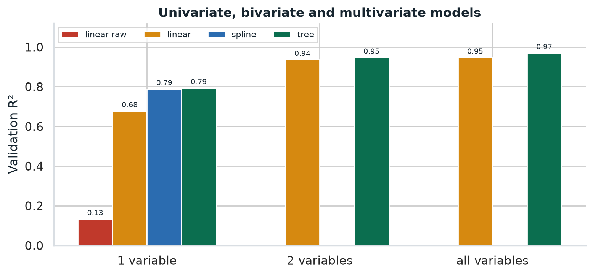

# How busy will Interstate 94 be at a given hour?

Forecasting hourly westbound traffic on Interstate 94 between Minneapolis and St Paul from the calendar and
the weather, following the whole machine learning process: problem definition, data collection, cleaning a
messy hourly series, feature engineering, a chronological split, algorithm selection, three
hyperparameter-search strategies, **feature importance with univariate, bivariate and multivariate models**,
a final test, ONNX export, a FastAPI service and monitoring.

Machine Learning Assignment 1, regression problem. Abel Mari Shiferaw (student ID GSR/1670/19), Machine Learning, instructor: Dr Fantahun Bogale Gereme, Addis Ababa University, College of Technology and Built Environment.

**Live demo and API:** [https://traffic-volume-i94.vercel.app](https://traffic-volume-i94.vercel.app)

## Results

Every number in this file is generated from `reports/metrics/pipeline/metrics.json`.

| | |
|---|---|
| Data | 48,204 rows, 2012-10-02 to 2018-09-30; 40,518 hours after cleaning |
| Split, by year | train to 2016: 25,272 hours / validation 2017: 8,713 / test 2018: 6,533 |
| Final model | HistGradientBoosting (hgb, tuned, all inputs), 139 KB as ONNX |
| **Test R²** | **0.965** (95% interval 0.953 to 0.975) |
| **Test RMSE** | **368** vehicles per hour (312 to 427); MAE 221; MSE 135,400 |
| Hour-of-week baseline on test | RMSE 468, R² 0.944: the model's RMSE is 21% lower |
| A lookup table that also knows the holidays | RMSE 396: the model's RMSE is 7% lower |
| Without weather (calendar-only model) | RMSE 377 |
| Success criteria (R² ≥ 0.9, beat the baseline) | both met; the baseline itself meets the R² criterion, so the comparison with the baseline is the one that matters |

**Read the R² with care.** Most of the variance in traffic is the daily and weekly cycle, which a lookup table
captures. What the model adds is knowledge of the holidays and the season, and it is weakest in snow
(45% of the test error from 8% of the hours).

**The test year was scored twice.** A review after the first evaluation (R² 0.964, RMSE
376, a 12 MB random forest) found four defects, fixed with training and validation
data only. `docs/PROCESS.md`, section 8.1, reports both evaluations.

## Feature importance and univariate, bivariate and multivariate models

Five ranking methods (association, mutual information, grouped permutation, tree importance, SHAP) put the
**hour** first and the **weekday** second. Validation R² by model family:

| Variables | Linear, raw | Linear, engineered | Spline | Tree |
|---|---|---|---|---|
| 1: hour | 0.133 | 0.677 | 0.788 | 0.793 |
| 2: hour, weekday | | 0.936 | | 0.946 |
| all nine | | 0.947 | | 0.969 |

A straight line in the raw hour underfits badly; the hour alone, read as a cycle, explains most of the
variance; hour and weekday together equal the hour-of-week baseline; the month and the holiday flag carry
nearly all of the rest, and the weather adds 2.5%.



## What is where

| | |
|---|---|
| `notebooks/01_traffic_volume_regression.ipynb` | **The code submission.** Self-contained: runs alone in Jupyter or Google Colab, follows the assignment's steps in order, executed with full budgets with every figure saved in it |
| `docs/PROCESS.md` (also `.docx`, `.pdf`) | **The process documentation:** every step, what was done, why, the alternatives and the result |
| `docs/MODEL_CARD.md`, `docs/ARCHITECTURE.md` | The model in one page; how the code is organised |
| `src/traffic_volume/` | The same work as a tested package; `rowlevel.py` is the feature code shared with the service |
| `service/` | The deployed API (FastAPI, ONNX): all that ships |
| `configs/config.yaml` | Every setting: cleaning rules, split years, budgets, success criteria |
| `reports/` | Figures and results files (the only source of numbers in the documents) |
| `tests/` | Unit, integration (pipeline, API) and parity tests |

## Run it

**The notebook.** Open `notebooks/01_traffic_volume_regression.ipynb` in Jupyter, or upload it alone to
Google Colab, and run all cells (about 20 to 30 minutes). It installs what is missing, downloads the data and
defines every function it uses. Set `ML_FAST=1` first for a run of a few minutes with tiny budgets.

**The pipeline** (the same code, stage by stage):

```bash
python -m pip install -e ".[dev]"   # exact pinned versions, Python 3.11 or later
traffic-volume all                  # every stage with full budgets, about 15 minutes
python -m pytest -m "not slow" -q   # unit, API and parity tests
traffic-volume feature-study        # or any single stage
traffic-volume all --fast           # smoke run; writes to build/fast/, never over the results
```

Stages, in order: `download`, `validate`, `clean`, `split`, `eda`, `train`, `tune`, `select`, `diagnose`,
`explain`, `feature-study`, `evaluate`, `export`, `report`.

**Everything from a fresh clone:**

```bash
python -m pip install -e ".[dev,docs]"
traffic-volume all                                   # results, figures, exported models
python scripts/sync_service.py                       # copy feature code and models into service/
(cd service && python -m uvicorn main:app --port 8765) &
traffic-volume monitor latency --url http://127.0.0.1:8765 && traffic-volume monitor drift
python scripts/check_live.py http://127.0.0.1:8765   # outside-in check of the running service
python -m pytest -q
```

## The service

`service/` is all that ships: FastAPI, NumPy and onnxruntime plus two ONNX models of 139 KB each.

| Endpoint | Purpose |
|---|---|
| `GET /` | Demo page: pick a date, see the day's forecast |
| `GET /docs` | Interactive documentation |
| `POST /api/v1/predict` | One hour. Only the time is required; the public holiday is worked out from the date |
| `POST /api/v1/predict/day` | A date in, 24 hourly forecasts out |
| `POST /api/v1/predict/batch` | Up to 168 hours |
| `POST /api/v1/feedback`, `GET /api/v1/feedback/summary` | The count that was really observed; the running error |
| `GET /api/v1/model`, `/health`, `/api/v1/metrics` | Model card, liveness, latency |

```bash
curl -X POST http://127.0.0.1:8765/api/v1/predict -H "Content-Type: application/json" \
  -d '{"datetime": "2026-11-26T08:00"}'
# calendar-only model; the reply names Thanksgiving Day

curl -X POST http://127.0.0.1:8765/api/v1/predict -H "Content-Type: application/json" \
  -d '{"datetime": "2026-11-19T08:00", "weather": {"temp_c": 4, "weather_main": "Clouds", "clouds_all": 75}}'
# calendar-and-weather model
```

Without weather the calendar-only model answers (test RMSE 377); with it, the champion
(368). Every reply says which model answered.

### Deployment (Vercel)

The service is deployed at https://traffic-volume-i94.vercel.app.

```bash
cd service
npx vercel login          # once
npx vercel --prod         # deploys this folder; note the address it prints
cd ..
python scripts/check_live.py https://traffic-volume-i94.vercel.app   # outside-in check of the live service
```

Measured against the live service, from the author's computer:
median 514 ms, 95th percentile 1211 ms, first request 567 ms (live).

## Tests and checks

- `python -m pytest -m "not slow" -q`: cleaning rules, the holiday calendar (against the federal calendar and
  against every day the source marks), features and their declared inputs, the split, metrics and both
  bootstraps, the API including bad input, and parity between the pipeline and the service (largest
  difference 0.0011 vehicles per hour).
- `python -m pytest -q` adds the end-to-end pipeline in a scratch folder and checks the export is
  byte-for-byte reproducible.

## Data and citation

Hogue, J. (2019). *Metro Interstate Traffic Volume* [Dataset]. UCI Machine Learning Repository.
https://doi.org/10.24432/C5X60B. Licence CC BY 4.0. A compressed copy is in `data/mirror/`; the download is
verified against a SHA-256 checksum whichever source it comes from.

Code: MIT licence (`LICENSE`).
