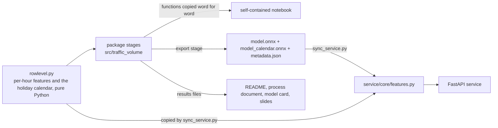
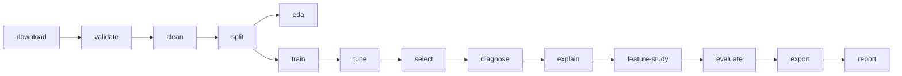

# Architecture

## Three consumers, one source of truth

- **The package** (`src/traffic_volume/`) is where code is written and tested.
- **The notebook** holds the package's source for every function it uses, copied word for word, with the
  third-party imports they need. It runs on its own, with no imports from the repository. For this to
  work, package modules import siblings by name and every top-level name is unique across the package.
- **The service** (`service/`) never imports the package. It gets a generated copy of `rowlevel.py` and the
  exported model files.
- **The documents** take every number from the results files in `reports/metrics/`, so none of them
  carries a hand-typed result.

## Pipeline stages

| Stage | Writes |
|---|---|
| download, validate | `data/raw/`, `data_audit.json` (structure, gaps, duplicates, sensor errors, recording of rain and snow) |
| clean, split | `data/interim/clean.pkl`, `cleaning.json`, `data/processed/splits.json`, `split.json`, `holiday_evidence.json` |
| eda | figures, `eda.json` (the data behind the figures) |
| train | `candidates.json`, `lags.json` |
| tune | `tuning.json` (each finished search is cached under a fingerprint of the data and budgets) |
| select | `champion.json`, the champion and the all-inputs model fitted on the training years |
| diagnose, explain | `diagnostics.json` (curves, verdict, slices, residuals), `explain.json` |
| feature-study | `feature_study.json` (rankings, VIF, univariate, bivariate and multivariate models, ablation) |
| evaluate | `test.json` (the only stage that reads the test year), the final models |
| export | `artifacts/export/` (two ONNX files, metadata, parity data), `deployment.json` |
| report | `metrics.json`, the single results file |

Results go to `reports/metrics/pipeline/`; each run also writes a manifest (git commit, configuration, package
versions, timing) to `artifacts/runs/`. A run with `--fast` writes everything under `build/fast/` instead, so
it cannot overwrite reported results.

## Module map

| Module | Responsibility |
|---|---|
| `config.py` | Typed configuration; rejects missing or unknown keys |
| `artifacts.py` | Run folders, JSON helpers, manifests |
| `data.py`, `validation.py` | Download (UCI, pinned mirror, repository copy) with checksum and deadline; quality audit |
| `cleaning.py` | Fixed, logged cleaning rules; one row per hour; quiet holidays; holiday evidence |
| `rowlevel.py`, `features.py` | Per-hour features with their declared inputs, the holiday calendar; fitted encoders inside the pipeline |
| `split.py` | Chronological split, time-series cross-validation, test-hour fingerprint |
| `models.py` | Candidate regressors, including the two lookup-table baselines as estimators |
| `tuning.py` | Grid, random and Bayesian search behind one interface |
| `evaluation.py` | Metrics, block and paired bootstraps, learning and complexity curves, slices, residuals |
| `experiments.py` | Lag-feature experiment by forecast horizon |
| `feature_study.py` | Five variable rankings, VIF, univariate, bivariate and multivariate models, input-group ablation |
| `workflow.py` | Steps shared by pipeline and notebook: finalists, champion rule, diagnostics, the test pass |
| `explain.py`, `export.py` | Permutation importance and SHAP; ONNX export, metadata, parity |
| `plotting.py` | Every figure, one style |
| `monitoring/` | Latency replay; PSI and KS drift |
| `pipeline.py`, `cli.py` | Disk-backed stages and the command line |

## Service

`service/main.py` loads the two ONNX models and `models/metadata.json` once at start-up. A request is
validated by Pydantic (`core/schemas.py`); the holiday is worked out from the date by the shared calendar
function; the request is converted to the raw variables (temperature back to Kelvin, as in the data), passed
through the shared feature code, encoded with the exported category codes and scored by ONNX Runtime. A
request with weather goes to the champion, one without to the calendar-only model. Predictions are never
below zero. Errors have one shape (`error`, `message`, `details`). Middleware adds an `X-Process-Time-ms`
header and logs one JSON line per request. Runtime dependencies are FastAPI, NumPy and onnxruntime only.

## Consistency checks

| Risk | Check |
|---|---|
| Service features differ from training | `test_service_sync.py`: `service/core/features.py` equals `rowlevel.py` |
| Service model is stale | `test_service_sync.py`: model files equal the export, byte for byte; version equals the file's fingerprint |
| Service predicts differently | `test_service_parity.py`: 200 hours through the API's own schema, both models, within 0.01 vehicles per hour; the service names the same holidays as the cleaned data |
| Export not reproducible | `test_pipeline_fast.py`: two exports give identical bytes |
| A fast run overwrites results | Fast mode writes to `build/fast/`; `test_pipeline_fast.py` checks nothing lands in `reports/` |
