# Predicting hourly traffic volume on Interstate 94

**Process documentation. Machine Learning Assignment 1 (the ML process): regression problem.**

Abel Mari Shiferaw  
Student ID: GSR/1670/19  
Course: Machine Learning  
Instructor: Dr Fantahun Bogale Gereme  
Addis Ababa University, College of Technology and Built Environment

**What this document is.** A step-by-step account of how the model was built, following the structure and
numbering of the assignment sheet (steps 1 to 6, 8, 10 and 11). For each step it says what was done, why,
which alternatives were considered and what the result was. It is written to be read without the code open.
Every result in it is generated from the project's results files, so it agrees with the notebook, the
deployed service and the slides. Run times and response latency are wall-clock measurements, not results:
the ones quoted here are those of the submitted notebook's own run, and another run would give other values.

**The result in one paragraph.** The model forecasts westbound vehicles per hour on I-94 from the calendar
and the weather. On 2018, a year it never saw, its RMSE is **368 vehicles per hour** and
its R² **0.965**. That R² sounds better than it is: a lookup table of the average for each
hour of each weekday already reaches R² 0.944 (RMSE 468). The model's
error is 21% below that table's, and 7%
below a table that also knows the public holidays. Almost all of what the model knows comes from the
calendar; the weather contributes about 2.5%, and the hours
it gets most wrong are snow hours.

---

## Summary

### Results at a glance

| | |
|---|---|
| Problem | Regression: westbound vehicles per hour at MnDOT station 301, I-94, Minneapolis-St Paul |
| Data | 48,204 rows, 2012-10-02 to 2018-09-30; 40,518 hours after cleaning |
| Split, by year | Training to 2016: 25,272 hours. Validation 2017: 8,713. Test 2018 (January to September): 6,533 |
| Final model | HistGradientBoosting, tuned by random search; 139 KB as deployed (ONNX) |
| Validation: MSE / RMSE / MAE / R² | 120,687 / 347 / 228 / 0.969 |
| **Test: MSE / RMSE / MAE / R²** | **135,400 / 368 / 221 / 0.965** |
| Test RMSE and R², 95% intervals | 312 to 427; 0.953 to 0.975 |
| Hour-of-week baseline on test | RMSE 468, R² 0.944 |
| Model against the baseline | RMSE 21% lower (95% interval 9% to 33%) |
| Model against a holiday-aware lookup table | RMSE 7% lower (4% to 10%) |
| Without any weather input (calendar-only model) | Test RMSE 377, R² 0.963 |
| Success criteria set in step 1 | R² of at least 0.9: met, but the baseline meets it too. Beat the baseline: met |
| Deployment | https://traffic-volume-i94.vercel.app. FastAPI service, two ONNX models of 139 KB each |
| Test year scored | Twice. First evaluation: R² 0.964, RMSE 376. See section 8.1 |

### Five findings

1. **Traffic is mostly a matter of the clock.** The hour alone explains 79% of the
   variance, the hour and the weekday together 94.6%. Any sensible model captures
   this, so R² near 0.95 is the starting point, not the achievement.
2. **Knowing the public holidays is the largest single improvement**, and only six of the eleven days the data
   names behave as holidays. Treating all eleven alike was the main defect of the first version of this work.
3. **What the machine learning adds over lookup tables is modest and real:** 7%
   on the test year over a table that knows the holidays, with an interval that excludes zero.
4. **The weather adds little.** 2.5% when it is known exactly,
   nothing when it is not. The service therefore runs two models and uses the calendar-only one when no
   weather is supplied.
5. **Snow is the weak point.** 45% of the test error comes from the 8% of
   hours with snow, and the data does not record how much snow fell.

### How the test set was used

The test year was scored **twice**. After the first evaluation I reviewed the work and found four defects.
They were fixed using training and validation data only, and the test year was then scored again. Section 8.1
gives both results side by side and explains what this does and does not affect.

---

## 1. Problem definition

**The business problem.** A road authority schedules lane closures for roadworks, plans signage and staffs
incident response around the traffic it expects. If it knows in advance how many vehicles will pass in each
hour of a given day, it can put roadworks into quiet hours and prepare for busy ones. The question is asked
days or weeks ahead, when rosters and works schedules are drawn up.

**The goal.** Supervised **regression**. The target is `traffic_volume`: the number of westbound vehicles
counted in one hour at Minnesota Department of Transportation station 301 on Interstate 94, between
Minneapolis and St Paul.

**What may be used as input.** Defining the moment of prediction fixes which inputs are legitimate. A forecast
made days or weeks ahead knows:

| Input | Known days or weeks ahead? |
|---|---|
| Hour, day of week, month | Yes: the calendar |
| Public holiday | Yes: holidays follow calendar rules |
| Weather in the hour being predicted | Only as a forecast, and only a few days ahead. The dataset holds the weather that was *observed* |
| Traffic counts from the preceding hours | No. They exist only at short horizons |

Two consequences follow, and both are measured later instead of being assumed. First, recent counts are
excluded from the model; a separate experiment (section 5) shows what they would add for a next-hour or
next-day forecast. Second, results obtained with observed weather are an upper bound on what a forecast can
deliver; sections 6.3 and 8.1 report what the model scores when the weather is not known at all, which is
the lower bound.

**Success criteria, fixed before modelling.**

- Test R² of at least 0.9 on a year the model has never seen.
- Lower RMSE than a strong naive forecast, the *hour-of-week baseline*: the average volume for the same hour
  of the same weekday in the training data.

**Metrics.** MSE, RMSE and R², the three the assignment names for regression, plus MAE because it reads
directly as a typical miss in vehicles per hour. All four are reported on the validation year and again on
the test year, with 95% confidence intervals.

**A caution about the R² criterion.** With hindsight the R² target was set too low: the baseline itself
reaches 0.944 on the test year, because most of the variance in traffic is the daily and
weekly cycle. The criterion was fixed in advance, so it stays as it was written, but throughout this
document the comparison with the baseline is treated as the result that matters.

## 2. Data collection

**Source.** Hogue, J. (2019). *Metro Interstate Traffic Volume* [Dataset]. UCI Machine Learning Repository.
https://doi.org/10.24432/C5X60B. Licence: Creative Commons Attribution 4.0 (CC BY 4.0), which permits use and
redistribution with attribution.

The dataset holds hourly traffic counts from the Minnesota Department of Transportation for October 2012 to
September 2018, joined by its author with hourly weather from OpenWeatherMap and with US public holidays:
48,204 rows and 9 columns.

| Column | Meaning |
|---|---|
| `date_time` | Hour of the count, local time (US Central) |
| `traffic_volume` | **Target**: westbound vehicles counted in the hour |
| `holiday` | Name of a US public holiday or the Minnesota State Fair; the text "None" otherwise |
| `temp` | Average temperature in the hour, Kelvin |
| `rain_1h`, `snow_1h` | Rain and snow that fell in the hour, mm |
| `clouds_all` | Cloud cover, % |
| `weather_main`, `weather_description` | Short and long description of the weather |

**Why a public dataset, and does it represent the problem?** The assignment allows public datasets where
appropriate, and here the public file is the official record: the counts are the road authority's own
measurements at the station the forecast is for, over six years, together with the calendar and weather
information a planner would have. It represents the problem for this road and direction. It does not
represent other roads, the eastbound direction, or the road after any physical change; those limits are
stated in section 11.

**How it is collected.** The code downloads the file itself, trying the UCI repository first, then a public
mirror pinned to a fixed version (through two different hosts), then a compressed copy kept in the project.
Whichever source answers, the file must match a recorded SHA-256 checksum, so every run uses byte-identical
data. Each download has a time limit for the whole transfer, so a slow connection moves on to the next
source instead of hanging.

*Alternative considered:* calling the Minnesota DOT and OpenWeatherMap APIs directly for more recent years.
Rejected for this assignment because the published dataset is citable and fixed, which makes the work
reproducible; fresher data is listed under next steps.

---

## 3. Data exploration and preparation

The assignment lists four activities here: exploratory data analysis, data cleaning, feature engineering and
data splitting. They were done in that order. The exploration has two parts, because the first look at the
raw file (3.1) is what shows how to clean it (3.2), and the patterns in the traffic (3.3) can only be read
once each hour appears once.

### 3.1 Exploratory data analysis, part 1: structure and quality of the raw file

**Missing values.** The file has **0 missing cells**. One trap had to be avoided:
the `holiday` column uses the text "None" for "no holiday", and a default CSV reader silently converts that
text into blanks. The file is therefore read with that conversion switched off.

What is missing is whole hours. Of the 52,551 hours between the first and last record,
**11,976 (23%) have no row at all**, in 12 gaps longer
than a day. The longest gap lasts 308 days.

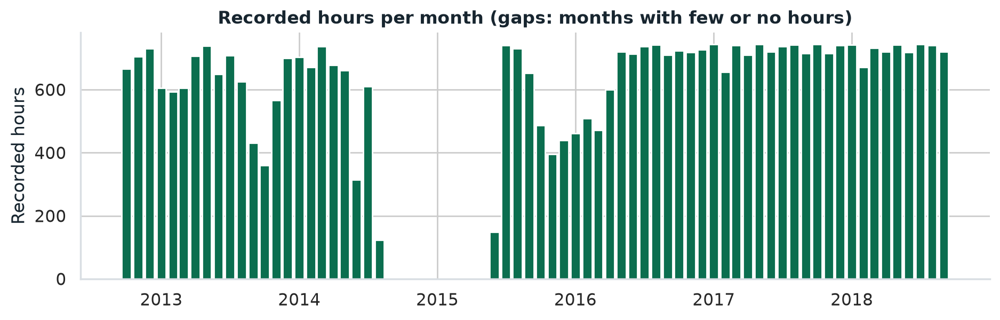

**Duplicates.** Two kinds were found. 17 rows are exact copies of another row. And
5,445 hours appear on several rows (up to 6), because
the source writes one row per weather condition reported in the hour and repeats the traffic count on each.
In 0 hours do those rows disagree about the count, which confirms
that they are repeats of one measurement.

**Outliers and impossible values.** 10 temperatures of 0 Kelvin;
1 rainfall reading of 9,831 mm in one hour; and 46 hours with
fewer than 100 vehicles. The quietest ordinary hour of the week averages
277 vehicles, so those 46 hours are not quiet
traffic: the road was closed or the counter was down. They cluster on a few days and fall in
2015, 2016 only.

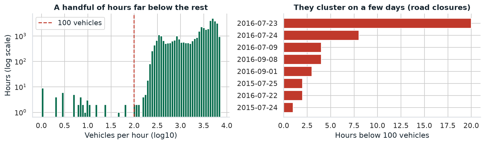

**Inconsistencies.** Two were found, and neither is documented with the dataset.

- *Holidays are marked on one row only.* The holiday name appears on 61 rows, each the
  midnight row of the holiday; the other 23 hours of every holiday read "None". Worse, 3
  holidays (2013-01-21, 2014-07-04, 2016-01-18) are not marked at all, because their midnight hour is one of the missing
  hours.
- *The rain and snow amounts are not recorded consistently.* In 2012 and 2017 not one rainy record
  carries a rain amount, and the snow amount is recorded in only 2 of 7 years. The
  weather *label* (`weather_main`) is recorded throughout.

| Year | Rainy records | of which with a rain amount | Snowy records | of which with a snow amount |
|---|---|---|---|---|
| 2012 | 253 | 0 | 197 | 0 |
| 2013 | 1,236 | 442 | 674 | 0 |
| 2014 | 888 | 758 | 79 | 0 |
| 2015 | 919 | 448 | 134 | 21 |
| 2016 | 1,680 | 487 | 692 | 10 |
| 2017 | 2,017 | 0 | 579 | 0 |
| 2018 | 1,538 | 524 | 521 | 0 |

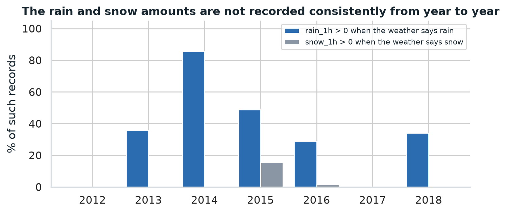

### 3.2 Data cleaning

Every rule is fixed in the configuration file and none is estimated from the data, so cleaning can run before
the data is split without leaking anything from the later years.

| Problem (assignment bullet) | Rule | Why, and the alternative rejected |
|---|---|---|
| **Missing values** | Leave the gaps as gaps | The target must never be invented. Interpolating a ten-month gap would manufacture training data, and the models used here do not need a continuous series |
| **Duplicates** | Drop exact copies; then keep one row per hour | The count is the same on every row of an hour, so nothing is lost. When the weather rows differ, the most severe condition is kept (a thunderstorm matters more than the clouds around it), with the hour's highest rain, snow and cloud readings and its mean temperature. Keeping every row would count some hours six times |
| **Outliers: impossible sensor values** | Drop rows with 0 K, or with more than 100 mm of rain in an hour | 11 rows. Imputing the weather would add a guess to hours that are otherwise ordinary |
| **Outliers in the target** | Drop hours with fewer than 100 vehicles | A closed road is not traffic. Left in, these hours teach the model that, for example, a July weekend is quiet, because on one July weekend the road was shut. None of them is in the validation or test year, so the rule cannot flatter the scores. Other unusual hours (storms, incidents, slow days) are real traffic and are kept |
| **Inconsistency: holiday marking** | Spread each holiday to all 24 hours of its day; name the holidays the source failed to mark | The holiday belongs to the day. The missing names come from the calendar rules for US federal holidays, written as a small function; a test confirms that the same function reproduces every day the source does mark |
| **Inconsistency: which days are holidays** | Treat only the six quiet holidays as holidays | Evidence below |
| **Inconsistency: rain and snow amounts** | Keep the columns, but take the rain and snow flags from the weather label as well | The label is reliable; the amounts are not. Section 6b shows the amounts carry no importance |

The cleaning log, as the code records it:

| Rule | Rows before | Rows after | Effect | Why |
|---|---|---|---|---|
| drop exact duplicate rows | 48,204 | 48,187 | 17 rows removed | The same record stored twice. |
| drop zero kelvin temperature | 48,187 | 48,177 | 10 rows removed | 0 K is a sensor error, not weather. |
| drop impossible rainfall | 48,177 | 48,176 | 1 row removed | More than 100 mm in one hour is a sensor error. |
| drop closure or outage hours | 48,176 | 48,116 | 60 rows removed | Fewer than 100 vehicles in an hour: the road was closed or the counter was down. |
| spread holiday to whole day | 48,116 | 48,116 | 1,348 values changed | The source marks a holiday only on its midnight row; every hour of that day is a holiday. |
| name holidays with no midnight row | 48,116 | 48,116 | 55 values changed | A holiday whose midnight hour is missing from the data was never marked; the calendar names it. |
| one row per hour | 48,116 | 40,518 | 7,598 rows removed | Hours with several weather rows repeat the same volume; keep one row, with the most severe weather. |
| treat only quiet holidays as holidays | 40,518 | 40,518 | 550 values changed | Named days on which traffic stays near normal (Columbus Day, Veterans Day and others) are ordinary days for the model; only the quiet holidays listed in the configuration count. |

The 46 closure hours of section 3.1 occupy 60 rows at this point, because some of those hours are written once per weather condition and the rule runs before the step that keeps one row per hour.

After cleaning there are **40,518 hours**, each appearing once, with no missing
value in any column.

**Which named days are holidays for traffic?** The source names eleven days. For each, the table compares its
traffic with an ordinary day of the same weekday. It uses the **training years only** (up to 2016), so that
this decision borrows nothing from the validation or test year.

| Named day | Days in training years | Traffic, share of a normal day | Lowest year | Highest year | Treated as |
|---|---|---|---|---|---|
| New Year's Day | 3 | 47% | 45% | 50% | holiday |
| Christmas Day | 4 | 49% | 41% | 63% | holiday |
| Thanksgiving Day | 4 | 55% | 53% | 57% | holiday |
| Independence Day | 4 | 61% | 57% | 73% | holiday |
| Memorial Day | 3 | 61% | 57% | 66% | holiday |
| Labor Day | 3 | 68% | 63% | 71% | holiday |
| Martin Luther King Jr Day | 3 | 80% | 78% | 82% | ordinary day |
| Washingtons Birthday | 3 | 86% | 72% | 93% | ordinary day |
| Veterans Day | 4 | 91% | 85% | 95% | ordinary day |
| Columbus Day | 4 | 99% | 96% | 104% | ordinary day |
| State Fair | 3 | 103% | 98% | 105% | ordinary day |

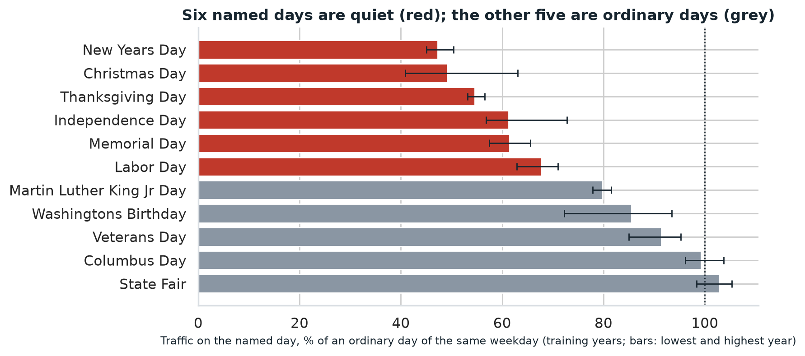

There are two clear groups, with a gap between them. On six days traffic falls to 47% to 68% of
normal: the days on which most workplaces close. On the other five it stays at 80% to 103%:
Columbus Day, Veterans Day and the opening day of the State Fair are ordinary commuting days. A single yes/no
flag covering all eleven tells the model that Veterans Day looks like Christmas, which is wrong in both
directions. The six quiet holidays (New Year's Day, Memorial Day, Independence Day, Labor Day, Thanksgiving Day, Christmas Day) are therefore the only ones treated as holidays, and
the list is fixed in the configuration.

*This rule was introduced after the first evaluation of the test set; see section 8.1.*

### 3.3 Exploratory data analysis, part 2: distributions, relationships and trends

From here on the exploration uses only the years **before the test year**. Up to this point 2018 has been
touched only by the audit and the cleaning rules of 3.1 and 3.2, which run on the whole file and involve no
modelling choice, and the split in 3.5 reports its row count and mean volume. Its traffic patterns were not
explored and no model was scored on it until the final evaluation, so no modelling decision could be shaped
by it.

**Distribution of the target.** Hourly volume has two humps, which turn out to be night and day.

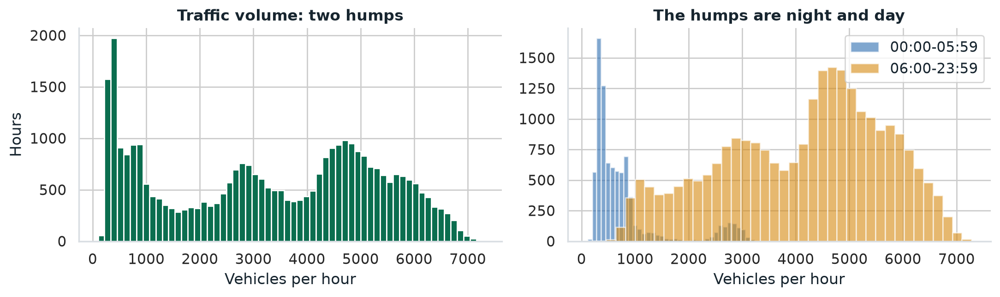

**Relationship with the clock and the calendar.** This is the most important picture of the dataset. Working
days have a morning and an afternoon rush hour; weekends and quiet holidays have one broad midday hump; the
five named days that are not quiet follow the working-day shape.

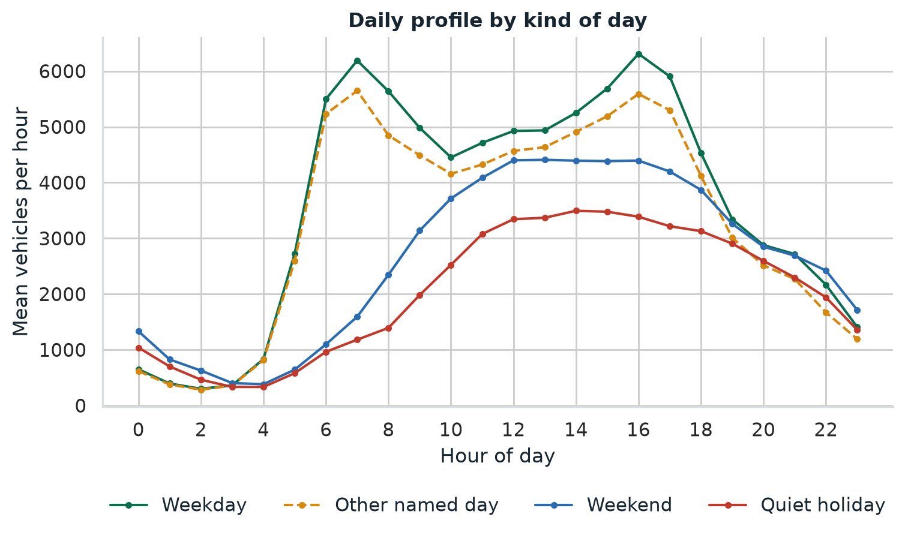

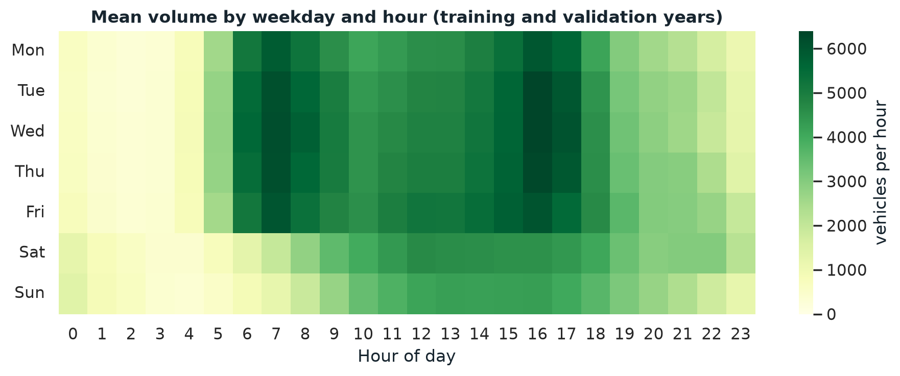

**Relationship with the weather.** Compared with the clock, the weather barely moves the volume. On working
days between 07:00 and 18:00 the median volume differs by less than a fifth between the best and the worst
weather type, while the hour of the day moves it by a factor of ten or more. People drive to work whatever
the weather.

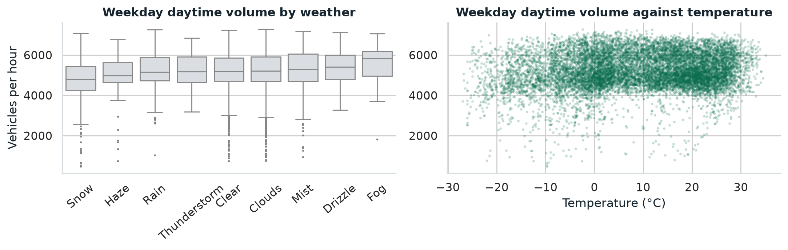

**Trend over time.** There is no steady growth or decline for a model to extrapolate.

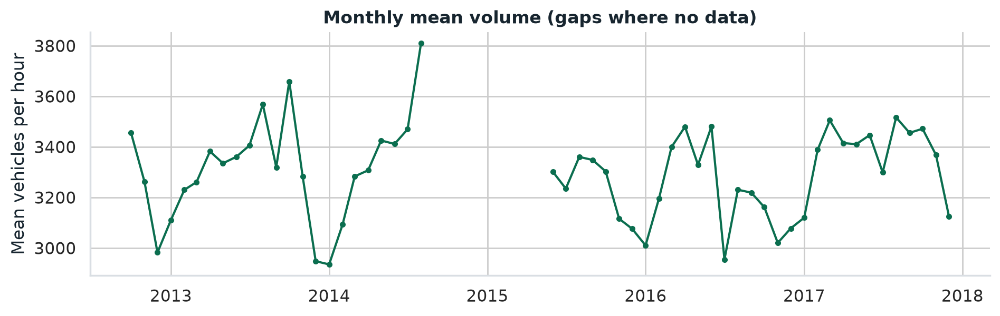

**What the exploration implies for modelling.** The signal is in the timestamp and has to be engineered out of
it; the hour and the day of the week interact (weekends have a different daily shape), which favours models
that can represent interactions; and the weather is unlikely to add much.

### 3.4 Feature engineering

**New features from existing ones.** All per-hour feature logic lives in one small module of plain Python
that the deployed service also runs, so training and serving cannot drift apart. The module also records
which raw variables each feature is computed from; section 6b relies on that to build models on one, two or
all variables without letting other variables leak in.

| Feature | From | Why |
|---|---|---|
| `hour`, `hour_sin`, `hour_cos` | hour | The daily cycle. Sine and cosine make 23:00 a neighbour of 00:00 |
| `weekday`, `is_weekend` | weekday | The weekly cycle |
| `rush_hour`, `hour_slot` | hour and weekday | Working-day rush hours; a 48-value profile such as "weekday-08" |
| `month`, `month_sin`, `month_cos` | month | Seasons |
| `is_holiday` | holiday | 1 on the six quiet holidays |
| `temp_c` | temperature | Kelvin to Celsius |
| `rain_1h`, `is_raining`, `snow_1h`, `is_snowing` | rain, snow, weather label | Amounts, and flags that also use the label because the amounts are unreliable |
| `clouds_all`, `weather_group` | clouds, weather label | Eleven weather labels grouped into six |

That is 18 features from 9 raw variables.

*Not used: the year.* Tree models cannot extrapolate to a year they have not seen, and the exploration showed
no trend worth fitting. *Not used: recent counts.* See sections 1 and 5.

**Encoding categorical variables and scaling numerical ones.** Both are learned from data (which categories
exist; the mean and spread of each number), so they are fitted **inside the model pipeline, on the training
rows only**, and refitted inside every cross-validation fold. Fitting them on the whole dataset would leak the
later years into training.

- **Linear models and the neural network** need comparable scales and cannot read text: categories are
  **one-hot encoded** and numbers are **standardised** to mean 0 and standard deviation 1.
- **Tree models** split on thresholds, so scaling changes nothing for them: categories become **integer
  codes** and numbers pass through unchanged.

The notebook shows the fitted scaler's means and standard deviations before and after, and the columns the
one-hot encoding produces.

**Multicollinearity.** The cyclical encodings and their raw versions are related by construction. The highest
variance inflation factor among the numeric features is 4.8 (`temp_c`), below the usual
concern level of 10, so the linear models' coefficients are stable.

### 3.5 Data splitting

The split follows the calendar and is never shuffled, because a planner trains on the past and predicts the
future.

| Set | Period | Hours | Used for |
|---|---|---|---|
| Training | October 2012 to 2016 | 25,272 | Fitting models; cross-validation inside it for the hyperparameter searches |
| Validation | 2017 | 8,713 | Comparing models, choosing settings and feature sets, every diagnostic |
| Test | January to September 2018 | 6,533 | The final evaluation of the models declared in advance |

*Alternative rejected: a random split.* Neighbouring hours are almost identical, so a random split puts
near-copies of test hours into training and flatters the score.

**Cross-validation that respects time.** Inside the training years the searches use an expanding window with
3 folds: each fold trains on everything before a date and is scored on the block after
it, so a model is never scored on hours older than its training data.

**The sets are uneven.** The validation year is almost complete and the test year has nearly every hour from
January to September, but the training years are thin: 2014 and 2015 each have about half their hours because
of the gaps, and the data ends in September 2018, so the test year has no autumn. Section 8.1 comes back to
what that means for the test estimate.

---

## 4. Algorithm selection

**Type of model.** Supervised regression: there is a numeric target for every hour. Unsupervised methods
(clustering, PCA) have no target to predict, and reinforcement learning fits sequential decisions with
feedback, not a forecast.

The candidates run from the simplest possible to the most flexible, so that every gain in accuracy can be
weighed against what it costs in complexity, interpretability and computation:

| Model | Complexity | Interpretability | Computational cost | Why it is a candidate |
|---|---|---|---|---|
| Hour-of-week average (baseline) | Lookup table, 168 numbers | Total | None | The bar to beat |
| The same table with quiet holidays as an eighth day type | Lookup table, 192 numbers | Total | None | Shows how much of any model's gain is simply knowing the holidays |
| Linear, Ridge, Lasso | Low | High: one coefficient per feature | Very low | Honest linear baselines; shrinkage handles correlated features |
| Polynomial Ridge | Medium | Medium | Low | Curved effects and interactions, still linear in its parameters |
| Decision tree | Medium | High if shallow | Low | Readable, but unstable |
| Random forest | High | Medium (importances, SHAP) | Medium; very large files | Robust non-linear model |
| HistGradientBoosting, LightGBM | High | Medium (SHAP) | Low | Usually the strongest on tabular data, in small files |
| Neural network (small MLP) | High | Low | Medium | Covers the neural-network family |

**The deployment constraint.** The service runs on a free serverless platform with a size limit and a cold
start, so among models of equal accuracy the smallest and simplest is preferred. That preference is written
into the selection rule of section 6.2. The measured accuracy, training time, prediction time and size of
every candidate are in the next section.

## 5. Model development and training

**Design.** Each candidate is a scikit-learn pipeline: the preprocessing of section 3.4 followed by the
estimator, fitted as one object, so that preprocessing is always learned from the same rows as the model.

**Training and first assessment.** Each candidate, with sensible default settings, is scored in two ways: by
time-series cross-validation inside the training years, and by a fit on all training years scored on the
validation year. The second is the number used to compare them.

| Model | CV RMSE | Validation MSE | Validation RMSE | Validation MAE | Validation R² | Fit (s) | Predict (ms per 1,000 h) | Size |
|---|---|---|---|---|---|---|---|---|
| HistGradientBoosting | 439 | 119,920 | 346 | 224 | 0.969 | 1.4 | 5.0 | 357 KB |
| Random forest | 427 | 121,488 | 349 | 226 | 0.969 | 4.2 | 21.9 | 67 MB |
| LightGBM | 455 | 127,907 | 358 | 230 | 0.967 | 1.2 | 17.2 | 2.6 MB |
| Neural network (MLP) | 462 | 137,487 | 371 | 247 | 0.965 | 7.0 | 1.7 | 168 KB |
| Decision tree | 448 | 140,859 | 375 | 245 | 0.964 | 0.2 | 1.8 | 140 KB |
| Hour-of-week average with quiet holidays | 433 | 141,367 | 376 | 244 | 0.964 | 0.0 | 0.8 | 10 KB |
| Polynomial Ridge | 462 | 149,993 | 387 | 267 | 0.962 | 0.3 | 6.3 | 5 KB |
| Linear regression | 503 | 209,698 | 458 | 308 | 0.947 | 0.2 | 2.2 | 4 KB |
| Ridge | 503 | 209,740 | 458 | 308 | 0.947 | 0.1 | 2.2 | 4 KB |
| Hour-of-week average (baseline) | 514 | 210,685 | 459 | 277 | 0.946 | 0.0 | 0.2 | 5 KB |
| Lasso | 505 | 212,440 | 461 | 313 | 0.946 | 5.4 | 3.8 | 4 KB |

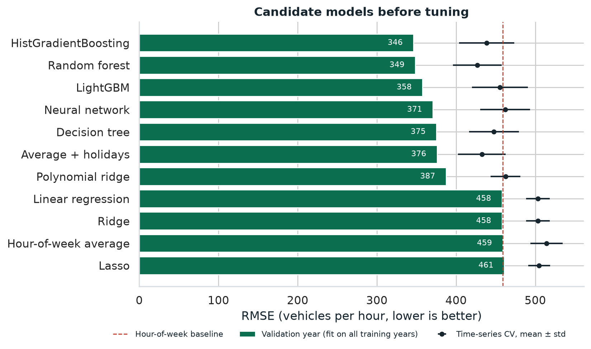

**What the table shows.**

- **The baseline is already strong:** validation R² 0.946, RMSE 459.
- **Knowing the holidays is worth a great deal.** The same lookup table with quiet holidays as an eighth day
  type scores RMSE 376, a cut of 18% from one rule and 24
  more numbers.
- **The best candidate, HistGradientBoosting,** scores RMSE 346: 25%
  below the baseline but only 8% below the holiday-aware table. That last figure is what
  machine learning adds over a table anyone could compute.
- **Plain linear models barely match the baseline** (Ridge 458): a weighted sum of
  features cannot give working days and weekends different daily shapes.
- **Cost.** The random forest's file is 68,609 KB against 357 KB for
  HistGradientBoosting at the same accuracy. Every model trains in seconds on this much data (the fit and
  prediction times are those of the notebook's run; they vary from run to run).
- The cross-validation errors are higher than the validation errors for every model because the early folds
  train on little data and are scored on the thin, gap-ridden years.

### Experiment: what would recent traffic counts add?

Section 1 ruled recent counts out for a forecast made days ahead. This experiment measures what is given up,
horizon by horizon: a count from *k* hours ago can only be used when the forecast is made less than *k* hours
ahead. The counts are aligned on the true hourly clock, so that a gap in the series leaves a missing value
instead of pairing hours that are not neighbours. Every row uses the same model (HistGradientBoosting with
default settings) fitted on the training years.

| Inputs | Usable when forecasting | Validation RMSE | MAE | R² |
|---|---|---|---|---|
| Calendar and weather only (the deployed inputs) | any horizon | 346 | 224 | 0.969 |
| + same hour last week | up to 7 days ahead | 341 | 221 | 0.970 |
| + same hour yesterday | up to 1 day ahead | 316 | 205 | 0.975 |
| + previous hour | next hour only; needs a live count feed | 241 | 157 | 0.985 |

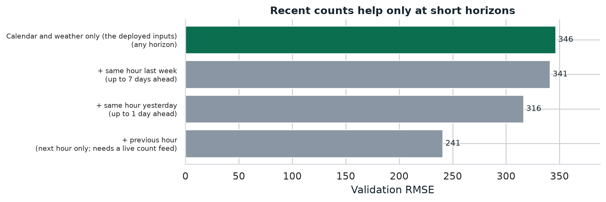

For planning a week or more ahead no recent count is available, and last week's count adds almost nothing.
A day ahead, yesterday's count cuts the error by 9%. For a true next-hour forecast the previous
hour's count cuts it by 30%, to 241.

**Decision.** The deployed model is the planning model and uses none of them: its inputs must be known days
ahead, and the service has no live feed of counts. A real-time service connected to the counter should add
them; that is the first item under next steps.

---

## 6. Model evaluation and hyperparameter tuning

### 6.1 Hyperparameter tuning: grid search, random search and Bayesian optimisation

- **Grid search** on Ridge (the regularisation strength).
- **Random search** on the random forest and on HistGradientBoosting.
- **All three strategies on LightGBM with the same budget** of 16 configurations, so
  that they can be compared fairly: a grid over three settings, and random search and Bayesian optimisation
  (Optuna's TPE sampler) over eight.

Every search scores each configuration by the time-series cross-validation of section 3.5, inside the
training years. The validation year is not used, so it stays untouched for choosing the final model. Seeds
are fixed, so the searches are repeatable.

| Model | Strategy | Configurations | Fits | Best CV RMSE | Seconds |
|---|---|---|---|---|---|
| Ridge | grid | 4 | 12 | 503.3 | 1 |
| Random forest | random | 10 | 30 | 425.6 | 26 |
| HistGradientBoosting | random | 16 | 48 | 432.9 | 76 |
| LightGBM | grid | 16 | 48 | 430.0 | 83 |
| LightGBM | random | 16 | 48 | 434.5 | 199 |
| LightGBM | bayesian | 16 | 48 | 425.7 | 105 |

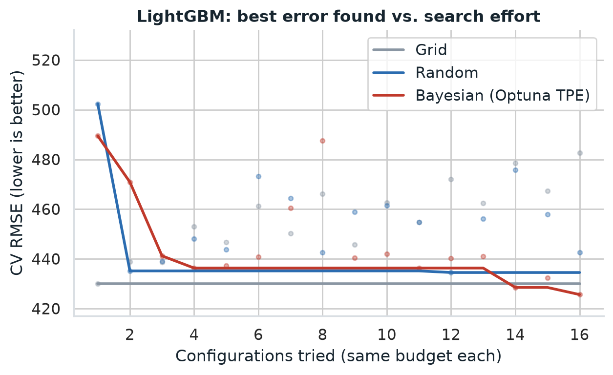

The seconds are wall-clock times of the notebook's run. With equal budgets the three strategies finish within 8.9 vehicles per hour of each other, with
Bayesian search ahead. Grid search can only find what is on its grid; random search covers more
of the space for the same cost; Bayesian search uses earlier results to decide where to look next. On a
problem this regular, with this budget, the choice of search strategy matters less than the choice of
features.

### 6.2 Choosing the final model on the validation year

Cross-validation nominated one setting per family. The validation year decides between the finalists: every
tree family with its tuned settings and with its default settings, each on **all inputs** and on the
**calendar inputs only** (hour, weekday, month, holiday; no weather).

**The rule, written down before looking:** lowest validation RMSE; models within 5.0 vehicles/hour count as equal and the simplest of them wins (fewest input variables, then smallest file).

| Finalist | Validation MSE | RMSE | MAE | R² | Size |  |
|---|---|---|---|---|---|---|
| hgb, default settings, all inputs | 119,920 | 346.3 | 224.1 | 0.9695 | 357 KB | tied |
| hgb, tuned, all inputs | 120,687 | 347.4 | 228.1 | 0.9693 | 246 KB | **champion** |
| rf, default settings, all inputs | 121,488 | 348.6 | 225.9 | 0.9691 | 67 MB | tied |
| rf, tuned, all inputs | 123,727 | 351.7 | 228.6 | 0.9685 | 20 MB |  |
| hgb, default settings, calendar only | 124,732 | 353.2 | 230.2 | 0.9683 | 354 KB |  |
| rf, tuned, calendar only | 126,188 | 355.2 | 232.4 | 0.9679 | 19 MB |  |
| lgbm, default settings, calendar only | 126,356 | 355.5 | 232.6 | 0.9678 | 2.6 MB |  |
| hgb, tuned, calendar only | 126,877 | 356.2 | 233.6 | 0.9677 | 243 KB |  |
| rf, default settings, calendar only | 127,319 | 356.8 | 234.9 | 0.9676 | 52 MB |  |
| lgbm, default settings, all inputs | 127,907 | 357.6 | 230.2 | 0.9675 | 2.6 MB |  |
| lgbm, tuned, all inputs | 135,849 | 368.6 | 255.1 | 0.9654 | 318 KB |  |
| lgbm, tuned, calendar only | 139,580 | 373.6 | 258.4 | 0.9645 | 316 KB |  |
| ridge, tuned, all inputs | 209,740 | 458.0 | 307.8 | 0.9466 | 4 KB |  |

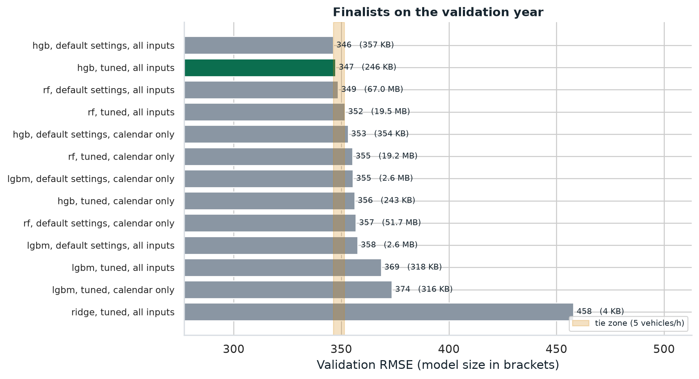

**The champion is hgb, tuned, all inputs**: validation RMSE 347.4 (MSE 120,687, MAE
228.1, R² 0.9693), 246 KB as a fitted pipeline. Settings:
`l2_regularization` = 2.9154, `learning_rate` = 0.1019, `max_iter` = 201, `max_leaf_nodes` = 10, `min_samples_leaf` = 31.

- The lowest validation RMSE of all is 346.3. The finalists within
  5 vehicles per hour of it count as equal (hgb, default settings, all inputs; hgb, tuned, all inputs; rf, default settings, all inputs), and among
  those the simplest wins. This is how a model of 246 KB was preferred to a random forest more
  than a hundred times its size.
- **Does the weather earn its place?** For the champion's settings, all inputs score 347.4 and the
  calendar inputs alone 356.2: the five weather variables improve the validation error by
  2.5%. That is outside the tie zone, so the weather stays in the champion; but see 6.3 for
  what happens when the weather is not known.
- **Tuning did not always carry over to a new year.**

| Family (all inputs) | Tuned, validation RMSE | Default, validation RMSE | Tuned size | Default size |
|---|---|---|---|---|
| Random forest | 351.7 | 348.6 | 20 MB | 67 MB |
| HistGradientBoosting | 347.4 | 346.3 | 246 KB | 357 KB |
| LightGBM | 368.6 | 357.6 | 318 KB | 2.6 MB |

  Where the tuned settings lose to the defaults, it is because the searches optimise the average of folds
  that are scored on the thin early years, which is not the same thing as predicting 2017 from everything
  before it. This is why the champion is chosen on the validation year, and why the default settings were
  kept in the comparison.

*Alternative rejected: choosing by cross-validation score alone.* It would have picked settings that fit the
early years and would have hidden the fact that tuning gains were small.

### 6.3 Underfitting or overfitting?

Three pieces of evidence, all from training and validation data.

**1. Error on the data the model was fitted on, against error on the validation year.**

| | MSE | RMSE | MAE | R² |
|---|---|---|---|---|
| Training years | 137,339 | 371 | 238 | 0.965 |
| Validation year | 120,687 | 347 | 228 | 0.969 |

The validation error is *lower* than the training error, by 6%. An overfitted model shows the
opposite. The reason is in the per-year table: every training year is harder to fit than 2017 (RMSE
359 to 406), because the training years contain the gaps and the least regular periods.

| Training year | Hours | RMSE | MAE | R² |
|---|---|---|---|---|
| 2012 | 2,103 | 406 | 245 | 0.959 |
| 2013 | 7,294 | 364 | 237 | 0.968 |
| 2014 | 4,491 | 370 | 225 | 0.965 |
| 2015 | 3,590 | 359 | 226 | 0.967 |
| 2016 | 7,794 | 372 | 251 | 0.963 |

**2. Learning curve: does more history help?** The model is refitted on the most recent *n* training hours and
scored on the whole validation year each time.

| Most recent training hours used | RMSE on those hours | RMSE on the validation year |
|---|---|---|
| 1,264 | 296 | 561 |
| 2,527 | 285 | 492 |
| 6,318 | 301 | 446 |
| 12,636 | 338 | 373 |
| 18,954 | 366 | 352 |
| 25,272 | 371 | 347 |

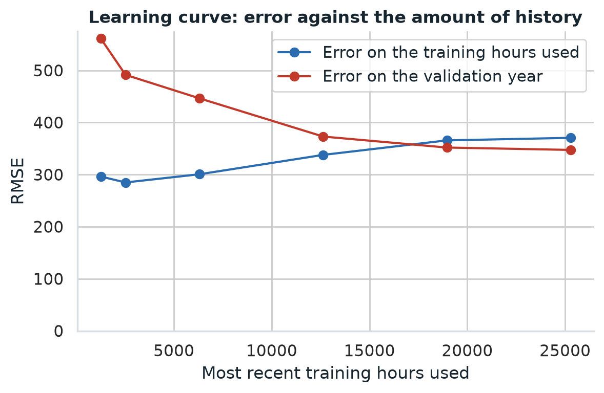

With only the most recent 1,264 hours the validation error is 561; with all
25,272 it is 347. The curve has flattened: the last quarter of the history
improves it by only a few vehicles per hour, so more years of the same kind of data would add little.

**3. Complexity curve: what happens as the model is given more or less capacity?**

| max_leaf_nodes | Training RMSE | Validation RMSE |
|---|---|---|
| 2 | 599 | 576 |
| 3 | 453 | 424 |
| 4 | 417 | 385 |
| 6 | 393 | 361 |
| 8 | 382 | 352 |
| 16 | 352 | 345 |
| 31 | 327 | 349 |
| 64 | 293 | 359 |
| 128 | 256 | 368 |

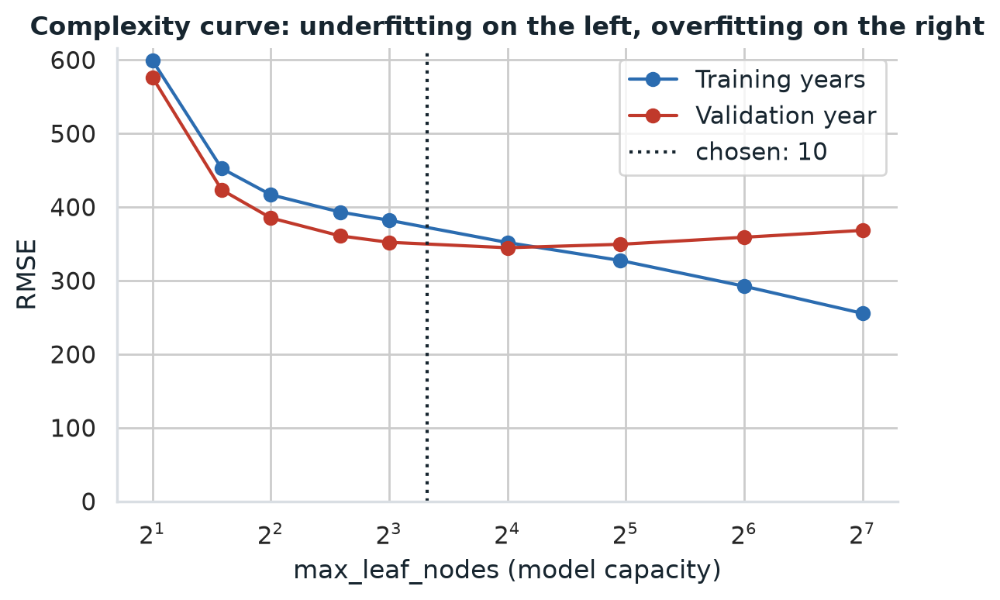

At the smallest capacity both errors are high and close together: that is **underfitting**, a model too simple
for the pattern. As capacity grows the training error keeps falling while the validation error reaches a
minimum and then rises again: the right-hand side is **overfitting**. The chosen setting
(max_leaf_nodes = 10) sits at the bottom of the validation curve.

**Verdict (generated from the numbers).** Validation error is 6% below training error: no overfitting. If anything the training years are the harder ones to fit; the table of training error by year shows which. On the complexity curve the validation error is lowest at max_leaf_nodes = 16 (345) and the chosen setting (10) is within 2% of it: more capacity would not help, so the model is not underfitting either.

The clearest example of underfitting in the project is in section 6b: a straight line in the raw hour.

**What if the weather is not known?** The scores so far give the model the weather that was observed. A
planner working weeks ahead has none. Scoring the champion on the validation year with each month's
*typical* weather in place of the real weather:

| Validation year | RMSE |
|---|---|
| Champion, weather known exactly | 347.4 |
| Champion, given typical weather for the month | 356.8 |
| Calendar-only model, which never sees weather | 356.2 |

A model trained to use the weather does slightly worse when handed typical weather than a model that never
relied on it. **Consequence:** two models are exported, and the service answers with the calendar-only model
whenever a request carries no weather.

### 6.4 Where the errors are (validation year)

One overall number hides where a model helps and where it fails.

| Kind of hour | Hours | Mean volume | Baseline RMSE | Holiday-aware table | Champion RMSE | RMSE reduction against the baseline | Share of champion's squared error |
|---|---|---|---|---|---|---|---|
| Weekday rush hours | 2,014 | 5,654 | 515 | 487 | 436 | 15% | 36% |
| Weekday midday | 1,265 | 4,858 | 269 | 262 | 245 | 9% | 7% |
| Weekday evening | 1,012 | 2,875 | 400 | 397 | 376 | 6% | 14% |
| Weekday night | 1,765 | 987 | 219 | 213 | 210 | 4% | 7% |
| Weekend | 2,513 | 2,758 | 402 | 402 | 374 | 7% | 33% |
| Quiet holiday | 144 | 2,125 | 1,965 | 373 | 385 | 80% | 2% |

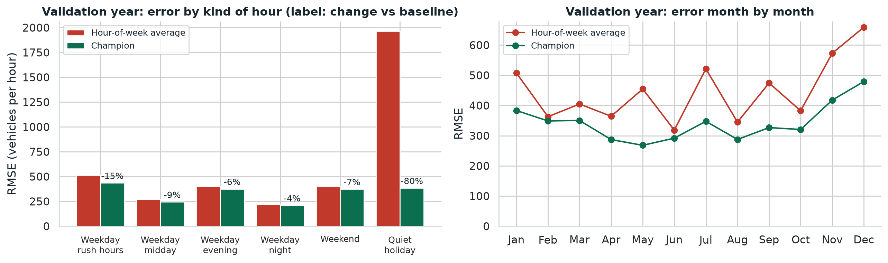

- **Quiet holidays are where the model earns most of its advantage.** There the baseline's RMSE is
  1,965 and the champion's 385.
  On all other hours together the champion's RMSE is 10% below the baseline's.
- **Rush hours are the hardest ordinary hours** (RMSE 436) and
  nights the easiest (210).
- **The last quarter is harder than the rest of the year:** RMSE 411
  in October to December against 323 in January to September.
  This matters in section 8.1, because the test year has no last quarter.

**The redefined holiday flag, checked on the validation year.** The table shows the champion's error on each
named day of 2017. Three of the five days now treated as ordinary (Columbus Day, State Fair and Veterans Day) are predicted about as well as the quiet holidays: RMSE 162 to 335, against 293 to 566 on the six holidays. The other two, Washington's Birthday and Martin Luther King Jr Day, are the worst named days of the year (RMSE 591 and 614): the model expects an ordinary working day and predicts about 370 and 364 vehicles an hour more than came. In the training years these days ran at 86% and 80% of normal (section 3.2): they are partial holidays, and a flag that can only say yes or no puts them on the wrong side. This is listed under the limitations.

| Named day (2017) | Treated as | Champion RMSE | Mean error (actual minus predicted) |
|---|---|---|---|
| Columbus Day | ordinary day | 162 | +39 |
| State Fair | ordinary day | 265 | +154 |
| Thanksgiving Day | holiday | 293 | +4 |
| Memorial Day | holiday | 293 | +44 |
| Christmas Day | holiday | 311 | +150 |
| Independence Day | holiday | 316 | +82 |
| Veterans Day | ordinary day | 335 | +228 |
| Labor Day | holiday | 447 | +244 |
| New Year's Day | holiday | 566 | +295 |
| Washingtons Birthday | ordinary day | 591 | -370 |
| Martin Luther King Jr Day | ordinary day | 614 | -364 |

**The worst days** are days when far fewer vehicles came than the calendar suggests: the day after
Thanksgiving, days between Christmas and New Year, and days with incidents or heavy snow. A model that knows
only the calendar and the weather cannot see them coming.

| Day | RMSE | Mean error |
|---|---|---|
| 2017-11-24 | 1,365 | -848 |
| 2017-12-05 | 1,126 | -652 |
| 2017-07-03 | 1,033 | -634 |
| 2017-12-26 | 826 | -562 |
| 2017-01-10 | 811 | -637 |
| 2017-03-01 | 777 | -257 |
| 2017-12-28 | 777 | -547 |
| 2017-12-02 | 721 | +569 |

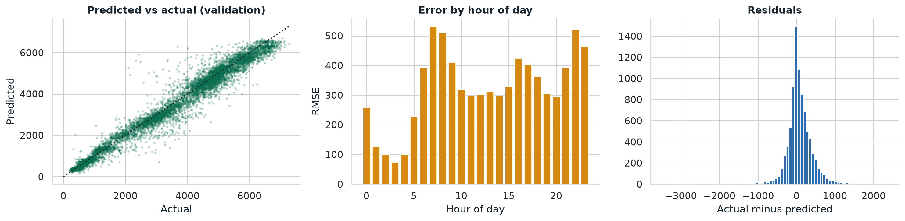

### 6.5 What the champion has learned

Permutation importance shuffles one feature at a time and measures how much the validation error rises; SHAP
values show how each feature moves individual predictions, in vehicles per hour. Both put the hour-of-day
features first by a wide margin.

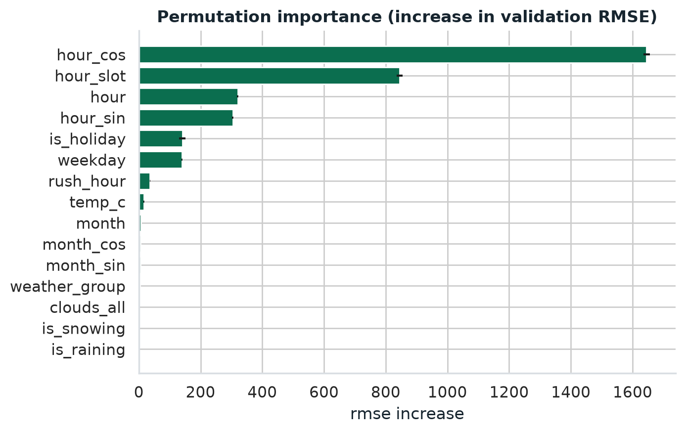

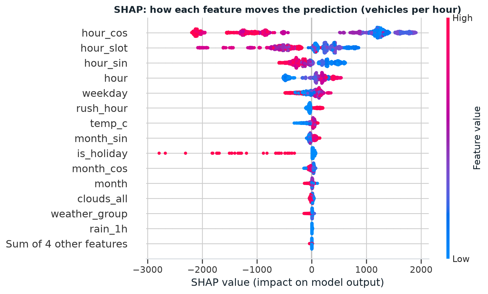

---

## 6b. Feature importance and univariate, bivariate and multivariate models

This section answers what the instructor asked for in addition to the assignment sheet: which variables
matter, and how well a model does on **one** variable (univariate), on **two** (bivariate) and on **all** of
them (multivariate).

**The unit of analysis is the raw variable**, not the engineered feature: hour, weekday, month, holiday,
temperature, rain, snow, clouds and weather type. One variable can become several features (the hour becomes
`hour`, `hour_sin` and `hour_cos`), and some features need two variables (`rush_hour` needs the hour and the
weekday). A model "on the hour" may use every feature made from the hour alone and none that also needs
another variable.

### Step 1: which variables matter? Five rankings

| Method | What it measures | Data |
|---|---|---|
| Association with the target | Correlation ratio (eta) for discrete variables, absolute Pearson correlation for continuous ones | Training years |
| Mutual information | Any dependence, including non-linear | Training years |
| Grouped permutation importance | Shuffle one raw variable, recompute every feature made from it, measure the rise in RMSE | Validation year |
| Tree importance | How much the model's splits on the variable reduce the error | The model |
| SHAP | Mean absolute contribution to a prediction, summed per variable | Validation year |

The first two look at the data alone; the last three look at a fitted model. The model used is the
champion's family and settings on all nine variables.

| Variable | Association | Mutual information | Permutation: rise in RMSE | Mean absolute SHAP | Rank: assoc. | MI | Perm. | Gain | SHAP | Mean rank |
|---|---|---|---|---|---|---|---|---|---|---|
| hour | 0.883 | 1.226 | 2,342.9 | 1,540.3 | 1 | 1 | 1 | 1 | 1 | 1.0 |
| weekday | 0.227 | 0.138 | 830.2 | 299.0 | 2 | 2 | 2 | 2 | 2 | 2.0 |
| temp | 0.148 | 0.053 | 16.1 | 48.8 | 3 | 3 | 5 | 4 | 4 | 3.8 |
| month | 0.068 | 0.032 | 22.3 | 67.0 | 6 | 4 | 4 | 5 | 3 | 4.4 |
| is_holiday | 0.086 | 0.010 | 141.3 | 45.8 | 5 | 7 | 3 | 3 | 5 | 4.6 |
| weather_main | 0.118 | 0.012 | 3.5 | 14.0 | 4 | 6 | 6 | 7 | 7 | 6.0 |
| clouds_all | 0.044 | 0.013 | 1.0 | 14.9 | 7 | 5 | 7 | 6 | 6 | 6.2 |
| rain_1h | 0.014 | 0.001 | 0.0 | 5.2 | 8 | 9 | 8 | 8 | 8 | 8.2 |
| snow_1h | 0.002 | 0.001 | 0.0 | 0.7 | 9 | 8 | 8 | 9 | 9 | 8.6 |

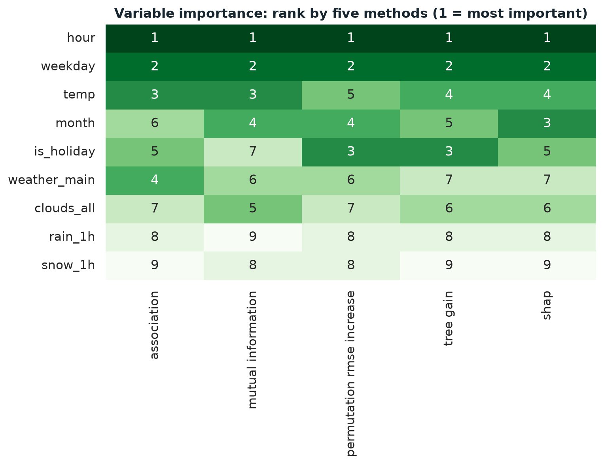

**The hour is ranked first by 5 of the 5 methods and the weekday second.** Below the top
two the methods disagree, and the disagreement is informative: the holiday flag has a weak association with
the target over the whole year, because holidays are rare, but a large permutation importance, because when
it matters it matters a lot. Shuffling the hour raises the validation RMSE by
2,343 vehicles per hour; shuffling the most important weather variable
raises it by 16.

### Step 2: models on one variable, two variables and all variables

The top one and top two variables come from the ranking. Four model families, from rigid to flexible, show
how much of the result is the variable and how much is the model:

- **linear, raw:** least squares on the untransformed variable only (for the hour: the number 0 to 23);
- **linear:** least squares on all of the variable's engineered features (for the hour: also sine and cosine);
- **spline:** a smooth flexible curve, periodic for the hour so that midnight joins up;
- **tree:** the champion's family with its settings.

A cyclical encoding turns one variable into several columns, but the model is still **univariate**: it uses
one variable. For contrast, the same four models are fitted on the main weather variable, temperature.

| Model | Variables | Family | Features | Validation MSE | RMSE | MAE | R² |
|---|---|---|---|---|---|---|---|
| univariate | hour | linear, raw | 1 | 3,408,046 | 1,846 | 1,641 | 0.133 |
| univariate | hour | linear | 3 | 1,269,381 | 1,127 | 837 | 0.677 |
| univariate | hour | spline | 3 | 833,034 | 913 | 638 | 0.788 |
| univariate | hour | tree | 3 | 813,828 | 902 | 625 | 0.793 |
| bivariate | hour, weekday | linear | 7 | 252,576 | 503 | 320 | 0.936 |
| bivariate | hour, weekday | tree | 7 | 210,726 | 459 | 277 | 0.946 |
| multivariate | hour, weekday, month, is_holiday, temp, rain_1h, snow_1h, clouds_all, weather_main | linear | 18 | 209,698 | 458 | 308 | 0.947 |
| multivariate | hour, weekday, month, is_holiday, temp, rain_1h, snow_1h, clouds_all, weather_main | tree | 18 | 120,687 | 347 | 228 | 0.969 |
| univariate (raw weather) | temp | linear, raw | 1 | 3,868,168 | 1,967 | 1,716 | 0.016 |
| univariate (raw weather) | temp | linear | 1 | 3,868,168 | 1,967 | 1,716 | 0.016 |
| univariate (raw weather) | temp | spline | 1 | 3,816,826 | 1,954 | 1,702 | 0.029 |
| univariate (raw weather) | temp | tree | 1 | 3,850,266 | 1,962 | 1,706 | 0.020 |

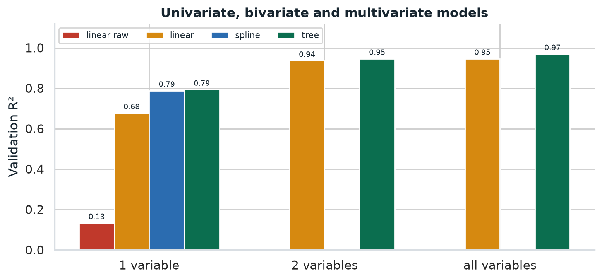

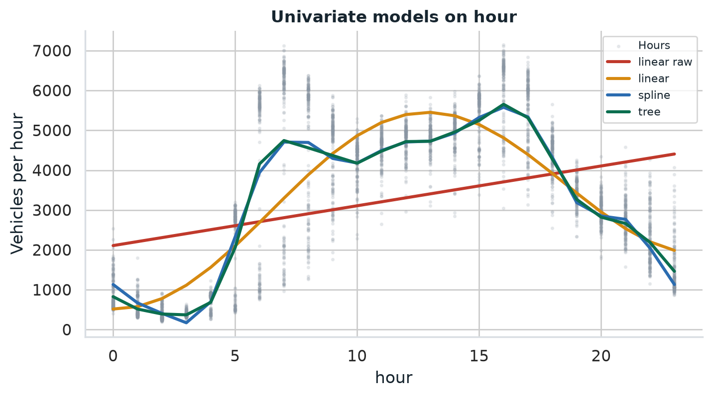

- **Univariate (hour).** A straight line in the raw hour reaches R² 0.13: it
  badly **underfits**, because traffic rises and falls twice a day and a line can only go one way. The same
  variable with a cyclical encoding lifts linear regression to 0.68, a periodic
  spline to 0.79 and a tree to **0.79**. How a
  variable is encoded matters as much as which variable it is.
- **Bivariate (hour and weekday).** The tree reaches R² **0.946** (RMSE
  459), the same as the hour-of-week baseline, which is a lookup table of the
  same two variables. The linear model on the same two variables reaches 0.936:
  the gap is the *interaction* between hour and weekday, which a tree finds and a sum of separate effects
  cannot.
- **Multivariate (all nine variables).** The tree reaches R² **0.969** (RMSE
  347); the linear model stays at 0.947. Going
  from two variables to nine cuts the tree's RMSE by 24%.
- **Contrast: temperature alone** reaches R² 0.020 with the most
  flexible model. A raw weather variable explains almost nothing on its own.

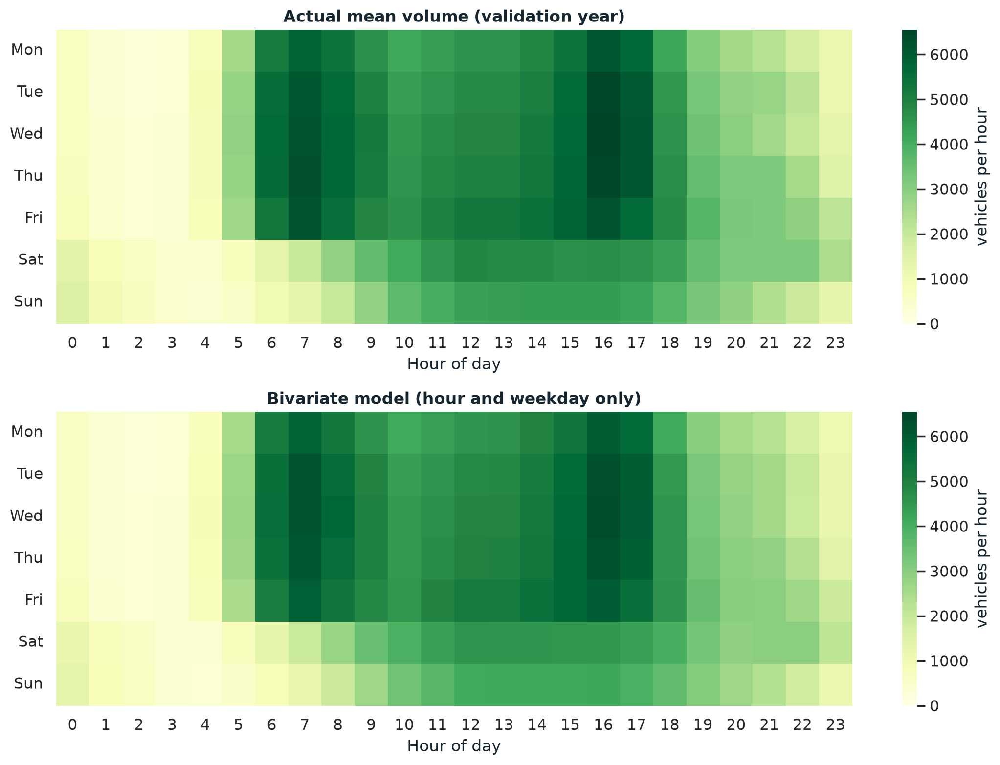

### Step 3: which of the remaining variables carry the multivariate gain?

Adding the variables one at a time, in the order of the ranking:

| Variables | Added | Validation RMSE | R² |
|---|---|---|---|
| 1 | hour | 902.1 | 0.7929 |
| 2 | weekday | 459.0 | 0.9464 |
| 3 | temp | 440.1 | 0.9507 |
| 4 | month | 429.7 | 0.9530 |
| 5 | is_holiday | 352.3 | 0.9684 |
| 6 | weather_main | 348.7 | 0.9691 |
| 7 | clouds_all | 348.4 | 0.9691 |
| 8 | rain_1h | 349.1 | 0.9690 |
| 9 | snow_1h | 347.4 | 0.9693 |

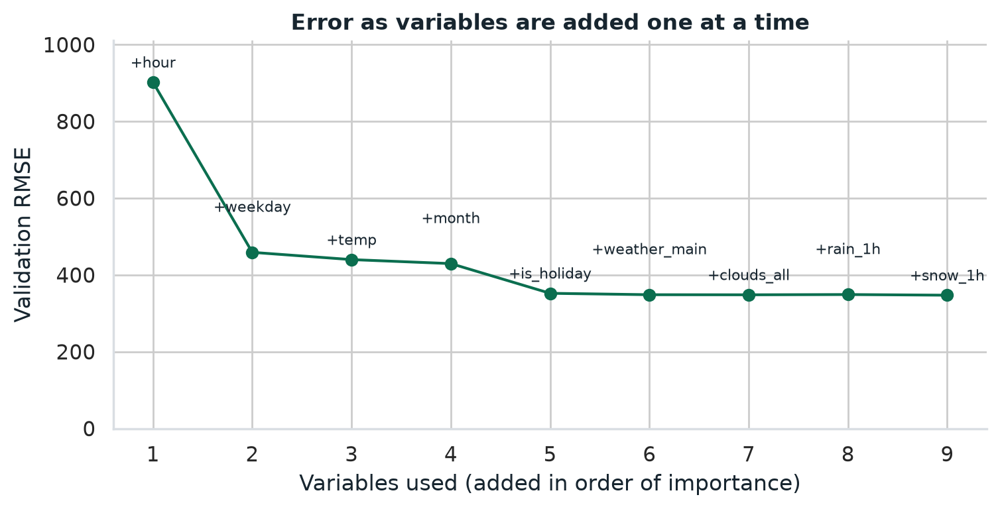

And adding them in groups, with the error reported separately for the hours with rain, storm or snow, where
the weather ought to matter most:

| Inputs | Variables | Validation RMSE | R² | RMSE, dry hours | RMSE, rain, storm or snow |
|---|---|---|---|---|---|
| Hour and weekday | 2 | 459.0 | 0.9464 | 460.4 | 454.0 |
| + month | 3 | 432.7 | 0.9524 | 436.8 | 417.4 |
| + holiday (all calendar inputs) | 4 | 356.2 | 0.9677 | 349.2 | 380.9 |
| + weather (all inputs) | 9 | 347.4 | 0.9693 | 339.6 | 374.5 |

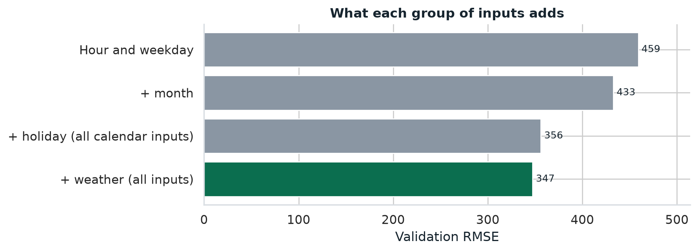

**The calendar carries the model.** The month and the holiday flag together cut the error of the bivariate
model by 22%; the five weather variables cut it by a further 2.5%, about as much in
dry hours as in wet ones. This agrees with the exploration (the weather barely moves the volume) and it has
a practical consequence: almost everything the model knows is known from the calendar alone, years ahead. The
concern raised in section 1, about using observed weather where a planner would have only a forecast, applies
to the last 2.5% of the error and not to the result as a whole.

---

## 8. Model testing and deployment

### 8.1 Final evaluation on the test year

**Procedure.** The models to be scored were fixed in the configuration file beforehand. Each is refitted on
the training and validation years together (for a time series the most recent year is the most valuable) and
then scored on 2018, with the same four metrics as on the validation year. Confidence intervals come from a
block bootstrap that resamples whole days, because neighbouring hours are not independent evidence. The
comparisons with the baselines use a *paired* bootstrap: both models are scored on the same resampled days,
so the interval describes the difference itself.

**The test year has been scored twice, and this must be said plainly.** The first evaluation
(2026-11-11) scored a random forest that treated all eleven named days as holidays. A review afterwards
found four defects:

1. the holiday flag included five ordinary commuting days (section 3.2);
2. three holidays were not marked at all (section 3.1);
3. road-closure hours were in the training data (section 3.2);
4. HistGradientBoosting, a far smaller model of equal accuracy, had never been among the tuned finalists
   (section 6.2).

All four were fixed, and **every choice was made on training and validation data**: the holiday grouping from
a training-year table, the closure rule from a fixed threshold that touches no validation or test hour, and
the model from the validation year. The test year was then scored again.

| | First evaluation (2026-11-11) | Second evaluation (reported) |
|---|---|---|
| Final model | Random forest, 12 MB | HistGradientBoosting, 139 KB |
| Named days treated as holidays | All eleven | The six quiet ones |
| Validation RMSE | 376 | 347 |
| Test R² | 0.964 | 0.965 |
| Test RMSE | 376 | 368 |
| Test MAE | 223 | 221 |
| Hour-of-week baseline, test RMSE | 468 | 468 |

*What this affects.* A test set that has been used twice is a slightly less clean estimate than one used
once, because the person doing the work has now seen a test result. No decision was taken from test results:
the fixes improved the validation error far more (376 to 347) than
the test error (376 to 368), which is what one would expect if the test
set had not guided them. The reported result is the second evaluation.

**Results for every declared model.**

| Model | Features | Test MSE | Test RMSE | Test MAE | Test R² |
|---|---|---|---|---|---|
| Hour-of-week average (baseline) | 2 | 219,008 | 468 | 265 | 0.944 |
| Hour-of-week average with quiet holidays | 3 | 156,446 | 396 | 237 | 0.960 |
| Ridge (tuned linear model) | 18 | 213,848 | 462 | 300 | 0.945 |
| Univariate: hour only | 3 | 829,988 | 911 | 619 | 0.787 |
| Bivariate: hour and weekday | 7 | 219,242 | 468 | 265 | 0.944 |
| Champion's settings, calendar only (no weather) | 11 | 142,459 | 377 | 223 | 0.963 |
| **Champion** | 18 | 135,400 | 368 | 221 | 0.965 |

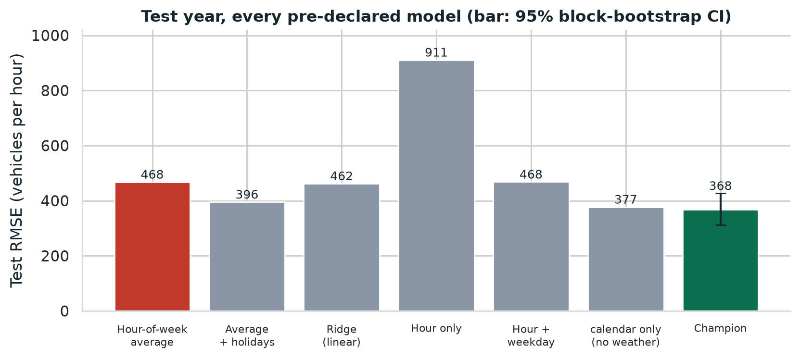

**The champion on the test year.**

| Metric | Test year | 95% interval | Validation year |
|---|---|---|---|
| MSE | 135,400 | 97,600 to 182,341 | 120,687 |
| RMSE (vehicles per hour) | **368** | 312 to 427 | 347 |
| MAE (vehicles per hour) | 221 | 202 to 243 | 228 |
| R² | **0.965** | 0.953 to 0.975 | 0.969 |

**Read against the baselines, which is the comparison that matters.**

| Reference on the test year | RMSE | R² | Champion's RMSE is lower by | 95% interval |
|---|---|---|---|---|
| Hour-of-week average (baseline) | 468 | 0.944 | 21.4% | 9.0% to 32.7% |
| The same table with quiet holidays | 396 | 0.960 | 7.0% | 4.1% to 10.2% |
| The champion's settings without weather (calendar-only model) | 377 | 0.963 | 2.5% | 0.3% to 4.4% |

The ladder reads: 468 for the plain table, 396 once the table
knows the holidays, 377 for the model on the calendar alone, and
368 when the weather of the hour is known as well. Every interval excludes zero, so each
step is real; the last two are small.

**When the weather is not known.** The champion given each month's typical weather scores RMSE
385 on the test year, worse than the calendar-only model's 377.
The figure to quote for a forecast made weeks ahead is therefore **377**, and
**368** is what is reached when the hour's weather is known exactly. A real weather
forecast lies between the two.

**Verdict against the criteria of step 1.**

- *Test R² of at least 0.9:* met (0.965). The baseline also meets it
  (0.944), so this criterion did not separate a good model from a lookup table.
- *Lower RMSE than the hour-of-week baseline:* met, by 21%, and the interval
  for the reduction excludes zero.

#### Where the model helps and where it does not

| Kind of hour | Hours | Baseline RMSE | Holiday-aware table | Champion RMSE | RMSE reduction against the baseline | Share of champion's squared error |
|---|---|---|---|---|---|---|
| Weekday rush hours | 1,525 | 508 | 501 | 448 | 12% | 35% |
| Weekday midday | 955 | 313 | 318 | 285 | 9% | 9% |
| Weekday evening | 764 | 365 | 365 | 341 | 7% | 10% |
| Weekday night | 1,331 | 189 | 181 | 180 | 5% | 5% |
| Weekend | 1,862 | 453 | 453 | 438 | 3% | 40% |
| Quiet holiday | 96 | 2,072 | 405 | 352 | 83% | 1% |

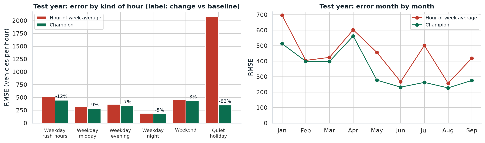

- **Holidays.** The test year contains 4 of the six quiet holidays. On those hours the
  baseline's RMSE is 2,072, the holiday-aware table's
  405 and the champion's
  352 (over 96 hours, so these figures
  are rough). Nearly all of the gain on holidays comes from knowing that the day is a holiday.
- **Ordinary hours.** On all other hours together the champion's RMSE is 7% below the
  baseline's. Rush hours remain the largest source of error
  (35% of the champion's squared error), and the gain at
  weekends is small (3%).

| Month (2018) | Hours | Baseline RMSE | Holiday-aware table | Champion RMSE | RMSE reduction against the baseline |
|---|---|---|---|---|---|
| January | 742 | 696 | 591 | 513 | 26% |
| February | 672 | 405 | 411 | 399 | 1% |
| March | 733 | 424 | 421 | 398 | 6% |
| April | 720 | 602 | 595 | 562 | 7% |
| May | 743 | 456 | 281 | 277 | 39% |
| June | 719 | 267 | 248 | 232 | 13% |
| July | 744 | 501 | 273 | 262 | 48% |
| August | 740 | 257 | 243 | 227 | 12% |
| September | 720 | 419 | 293 | 275 | 34% |

The champion beats the baseline in 9 of 9 months. The gain is large in the months
that contain a quiet holiday (January, May, July, September) and small elsewhere.

| Weather | Hours | Baseline RMSE | Calendar-only model | Champion RMSE | Share of champion's squared error |
|---|---|---|---|---|---|
| Clear or cloudy | 4,324 | 415 | 296 | 297 | 43% |
| Low visibility | 604 | 271 | 234 | 230 | 4% |
| Rain or storm | 1,089 | 438 | 264 | 265 | 9% |
| Snow | 516 | 917 | 926 | 875 | 45% |

- **Bad weather.** In rain or storm the champion's error is about the same as in clear or cloudy hours.
  **Snow is different: RMSE 875.** The 516 snow hours are
  8% of the test hours and produce **45% of the champion's squared error**;
  even the baseline does no better there. Heavy snow keeps people off the road, and the model cannot tell a
  flurry from a blizzard, because the data's snow amount is empty for most years (section 3.1): all it sees is
  the label "Snow". This is the model's largest weakness.

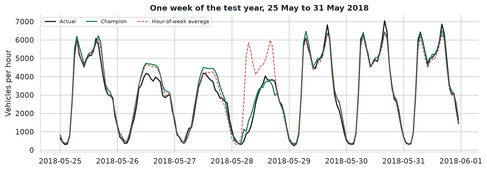

#### Is the test year representative?

Not entirely, and the estimate should be read with that in mind.

- **No autumn.** The data ends in September 2018, so the test year has no October to December, the quarter
  with Thanksgiving, Christmas and the hardest hours. On the validation year the champion's RMSE was
  411 in that quarter against
  323 in January to September. A full year would probably
  score worse than the 368 reported here.
- **Comparing like with like.** For January to September alone the validation year's RMSE is
  323; the test year, the same months, scores
  368, which is +14%. The near-agreement of the two full-period figures
  (347 and 368) is partly a coincidence of which months each covers.
  The honest size of the gap between the year the model was chosen on and a new year is
  +14%, much of it from the snow of early 2018.
- **Coverage is not the problem.** The test year has 6,533 of the 6,552 hours from January to
  September. It is one year, on one road, with 4 quiet holidays; the confidence intervals
  say how much the score could move with a different set of days.

### 8.2 Export

The champion, fitted on the training and validation years, is converted to **ONNX**, so that the service
needs only the small `onnxruntime` library and not scikit-learn. Because the champion uses the weather, the
calendar-only model from the test pass is exported beside it. A metadata file carries each model's feature
order, category codes and test results, and the list of quiet holidays.

| | Champion | Calendar-only model |
|---|---|---|
| Inputs | Calendar and weather | Calendar only |
| ONNX file | 139 KB | 139 KB |
| Version | `hgb-a5959e97b784` | `hgb-22eddc348a3d` |
| Largest difference from the scikit-learn pipeline, 200 hours | 0.0011 vehicles/hour | 0.0011 vehicles/hour |

**Parity check.** For 200 hours of the validation year, each exported model, run the way the
service runs it (shared feature code, then category codes, then ONNX), must reproduce its scikit-learn
pipeline to within 0.01 vehicles per hour; the export fails otherwise.

**Versions.** A model's version is a fingerprint of its file. The export was made byte-for-byte reproducible,
so the notebook, the pipeline and the service all show the same version for the same model. (In the first
version of this work the notebook and the service showed different versions for one model.)

*Technical note.* The ONNX converter for this model family fails with the current ONNX library because it
passes booleans where integers are expected. The export wraps the conversion and converts those values; the
parity check confirms the result.

### 8.3 Deployment

The service is deployed at https://traffic-volume-i94.vercel.app.

The model is served by a **FastAPI** application. It loads the two ONNX files and the metadata once, computes
the features with the same code the notebook uses, and answers in a few milliseconds.

| Endpoint | Purpose |
|---|---|
| `GET /` | Demo page: pick a date, see the 24-hour forecast as a chart |
| `GET /docs` | Interactive API documentation |
| `GET /health` | Liveness and the versions of the models being served |
| `GET /api/v1/model` | Model card: inputs, test results, limits |
| `POST /api/v1/predict` | One hour in, vehicles per hour out |
| `POST /api/v1/predict/day` | A date in, 24 hourly forecasts out |
| `POST /api/v1/predict/batch` | Up to a week of hours in one call |
| `POST /api/v1/feedback`, `GET /api/v1/feedback/summary` | Report the count that was really observed; see the running error |
| `GET /api/v1/metrics` | Request counts and latency of the running instance |

**Design decisions.**

- **Only the time is required.** The public holiday is worked out from the date by the same calendar function
  used in cleaning, so a client cannot get it wrong; it can be overridden.
- **The weather is optional, and decides which model answers.** With it, the champion; without it, the
  calendar-only model. Every reply states which model answered and that model's test RMSE.
- **Bad input is refused with an explanation.** An impossible date, an unknown field, a temperature outside
  the range of the training data or malformed JSON gets a 422 reply with a sentence a person can read; the
  service does not crash, and an unknown address gets a helpful 404.
- **Small footprint.** The runtime dependencies are FastAPI, NumPy and onnxruntime. The two models together
  are under 0.3 MB.

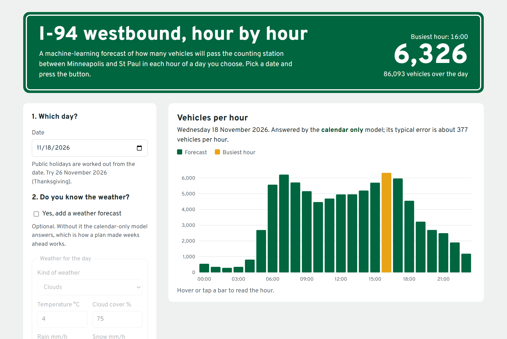

**Integration into existing systems.** Any system that can send an HTTP request can use the service. The demo
page calls it from the browser exactly as a traffic-management dashboard would; the notebook calls it from
Python as a planning script would.

**Checks.** An outside-in check script (`scripts/check_live.py`) ran 32 checks against https://traffic-volume-i94.vercel.app: 32 passed, 0 failed. Automated tests cover the API in-process, including the bad-input cases, and
check that the service's feature code is a byte-for-byte copy of the package's and that its model files are
the exported ones.

---

## 10. Monitoring and maintenance

Three questions have to be answered regularly once a model is live: is the service healthy, is the incoming
data still like the training data, and is the model still accurate? The answers feed a retraining policy.
Section 10 of the notebook runs each check on the 2018 hours, as the report that would be re-run
on a schedule.

**Response latency.** 300 real hours were sent one at a time to https://traffic-volume-i94.vercel.app/api/v1/predict in the notebook's run (its section 10.1): first request 841 ms, then a median of 582 ms, a 95th percentile of 1130 ms and a 99th of 1431 ms from the caller's side; 0 failed requests. The service's own processing took a median of 1.7 ms. Every answer matched the offline model to within 0.0022 vehicles per hour. Almost all of the caller's time is therefore the network path between the author's computer and the hosting region, not the model.

A second replay of 300 hours from the command line (`traffic-volume monitor latency`, saved in `reports/metrics/pipeline/monitoring.json`) gave a median of 514 ms and a 95th percentile of 1211 ms, but 9 of its 300 requests took between 15.6 and 21.5 seconds (99th percentile 15,687 ms). The service's own processing in that run again took a median of 1.6 ms and no request failed, so the waiting happened between the caller and the platform, not in the model. The cause was not traced further. Latency is a wall-clock measurement and differs from run to run; the figures quoted first are the ones the notebook's saved output shows.

**Data drift.** The population stability index (PSI) compares the distribution of each feature in a later
period with the training data: below 0.1 is stable, above 0.25 a large shift. It needs no counts, so it is
available the day the inputs arrive. Between the training years and 2017, 0 of 18 features shift strongly (PSI above 0.25) and 1 moderately; the largest shift is `clouds_all` (PSI 0.218, moderate). When the test year is compared with the same months of the earlier years, the number of features that shift strongly is 1 and moderately 0; the largest shift is `clouds_all` (PSI 0.266, large). Calendar features cannot drift
when the same months are compared. The shifts are in weather columns: partly real, since one year is cloudier
than another, and partly an artefact of how they are recorded.

**Performance on real data.** The alert line is the validation RMSE plus 15% (400 vehicles per
hour). Treating 2018 as the months after deployment and sending every week through the service, 7 of 39 weeks are above the alert line of 400, and the longest run above it is 3 weeks (from the week of 2018-01-08). The rule asks for three weeks in a row, so it would have fired once. The weeks above the line had on average 51 hours of snow each, the weeks below it 5: the cause is the weather, not a change in how the road is used. An alert is a reason to look before acting; here the lasting fix is a snowfall input, not more of the same data. By month, the test year would have crossed the line in: January, April.

**Collecting feedback.** Every prediction carries an id. When the counting station reports the real count, the
client posts it to `/api/v1/feedback` with that id. The service keeps a running summary of its own error
(count, MAE, RMSE, bias), and the logged pairs are the labelled data for the next retraining. The notebook
exercises this loop with real test-year hours.

**Retraining policy.**

| Signal | How it is measured | Action |
|---|---|---|
| Error drift | Weekly RMSE on hours whose real count has arrived | Retrain if it stays above 400 for three weeks in a row |
| Bias | Weekly mean of actual minus predicted | Investigate if it stays beyond 150 vehicles per hour in one direction for three weeks in a row: a lasting change to the road, not noise |
| Input drift | Monthly PSI of every feature the model reads | Investigate any PSI above 0.25 |
| Calendar | Every January | Retrain on all years to date; add any new public holiday to the list |
| Service health | 95th-percentile latency and error rate, from the logs | Alert above 1 second or above 1% errors |

Single weeks above the alert line are investigated, not acted on: one bad week is usually a storm or a
holiday week, and retraining on it would not help. Retraining itself is one command; it rebuilds the model
from all data to date, exports it with a new version, and the parity check guards the hand-over.

**What the other rules did in this period.**

*Bias.* The weekly mean error was beyond 150 vehicles per hour in 4 weeks of 39 (the weeks of 5 February +170, 19 February -215, 9 April -425 and 2 July -176). The longest run on one side is 1 week, and the rule asks for three in a row, so it did not fire: the model was not consistently too high or too low.

*Input drift.* `clouds_all` (PSI 0.266) is above the limit of 0.25 when the test year is compared with the same months of the earlier years, so it was looked at. The champion reads this input, but the weather as a whole accounts for about 2.5% of its accuracy, and the weeks with large errors are the weeks with snow, not weeks that stand out for this input. No action was taken beyond keeping it under watch; the calendar-only model does not read it at all.

*Service health.* The 95th percentile was 1130 ms with 0.0% failures. That is above the limit of one second, so the alert fired. The service's own processing took a median of 1.7 ms, so the time is spent on the network path between the caller and the hosting region, not in the model: the remedy would be hosting nearer the callers, and the rule is better applied to latency measured where the clients are.

**What is not built.** The free serverless platform keeps nothing between restarts, so the feedback summary
lives only as long as one running instance and the durable record is the request log. A small hosted database
for the feedback is the next step for a real deployment.

## 11. Documentation and reporting

### What was delivered

| Deliverable | Where |
|---|---|
| Working code as a notebook | `1_Code_Notebook.ipynb` in the submission folder (in the source code: `notebooks/01_traffic_volume_regression.ipynb`): self-contained, executed from top to bottom with full budgets, every figure and table saved in it |
| The same code as a tested package | `4_Source_Code.zip` in the submission folder, which is the project repository: `src/traffic_volume/`, run by `traffic-volume all`; the notebook's function cells are copied from it word for word |
| Deployment endpoint | `service/` in the source code (FastAPI); https://traffic-volume-i94.vercel.app |
| Process documentation | This document: `2_Process_Documentation` in the submission folder, `docs/PROCESS` in the source code |
| Presentation | `3_Presentation.pptx` in the submission folder: slides |

### Reproducibility and checks

- **One source of numbers.** The pipeline writes its results to one file; this document, the README, the model
  card and the slides are generated from it, and they were checked against each other before submission.
  Run times and latency are taken from the notebook's run instead, as said at the start.
- **The notebook and the pipeline run the same code.** The notebook's function cells are generated from the
  package's source, and after each full run of the notebook its results file was compared with the
  pipeline's: same cleaning counts, same test hours (by fingerprint), same test metrics, same model version.
  The generator and that comparison are development tooling and are not part of the submitted source code.
- **Fixed seeds and pinned versions.** The random seed is 42; every package version is pinned.
- **Verified data.** The download is checked against a SHA-256 checksum.
- **Tests.** Unit tests (cleaning rules, the holiday calendar, features and their declared inputs, the split,
  metrics, both bootstraps, the baselines), API tests including bad input, parity tests between pipeline and
  service, and an end-to-end run of the whole pipeline in a scratch folder.
- **The notebook runs alone.** It was executed in an empty folder that held nothing but the notebook file,
  which is what happens when it is uploaded to Google Colab: it downloads the data and defines every function
  itself.

### Limitations

- **One counting station, one direction, six years.** Nothing here says how the model would do on another
  road.
- **The test year is January to September of one year**, without the hardest quarter, and it has been scored
  twice (section 8.1). A full year would probably score somewhat worse.
- **Unusual days are invisible to the model.** The day after Thanksgiving, the days between Christmas and New
  Year, incidents and closures cause the largest errors. The model knows only six holidays.
- **Partial holidays.** Washington's Birthday and Martin Luther King Jr Day are partial holidays (traffic at 86% and 80% of normal) that the yes/no holiday flag treats as ordinary days; on the validation year the model over-predicted them by about 370 and 364 vehicles an hour. A graded holiday input would be needed to capture them.
- **Snow.** 45% of the test error comes from 8% of the hours, and the data
  does not record how much snow fell.
- **Weather is observed, not forecast.** The headline RMSE of 368 assumes the hour's weather
  is known exactly; with no weather knowledge it is 377.
- **Thin training years.** 2014 and 2015 have about half their hours.
- **The model does not extrapolate.** A new lane, a new interchange or a lasting change in commuting habits
  would shift the whole pattern, and the model would be wrong until retrained.
- **Monitoring is demonstrated, not operated.** Feedback is kept in memory only, and the latency figures in
  this document are median 582 ms, 95th percentile 1130 ms, first request 841 ms (live, from the notebook run).

### What I would do next

1. **A real-time version** that adds the counts of the previous hour and day: the experiment in section 5
   shows the error falling from 346 to 241 for a next-hour forecast.
2. **A richer calendar:** the day after Thanksgiving, the Christmas to New Year week, school holidays and
   large local events, which account for most of the worst days, and a graded value in place of the yes/no
   flag for the partial holidays.
3. **A proper snow input**, from a weather source that records snowfall, since snow is where the error is.
4. **Prediction intervals** (quantile regression), so that a planner sees a range for each hour.
5. **More recent data** and a rolling re-evaluation one year at a time, to see how fast the model ages.
6. **Durable feedback storage** and a scheduled run of the monitoring section of the notebook.

### References

- Hogue, J. (2019). *Metro Interstate Traffic Volume* [Dataset]. UCI Machine Learning Repository.
  https://doi.org/10.24432/C5X60B. Licence CC BY 4.0.
- Pedregosa, F. et al. (2011). Scikit-learn: Machine Learning in Python. *Journal of Machine Learning
  Research*, 12, 2825-2830.
- Ke, G. et al. (2017). LightGBM: A Highly Efficient Gradient Boosting Decision Tree. *Advances in Neural
  Information Processing Systems 30*.
- Akiba, T. et al. (2019). Optuna: A Next-generation Hyperparameter Optimization Framework. *KDD 2019*.
- Lundberg, S. M. and Lee, S.-I. (2017). A Unified Approach to Interpreting Model Predictions. *Advances in
  Neural Information Processing Systems 30*.
